# SceneAgent expansion on the SimFoundry fork

Design of the `sceneagent` package as it exists on `sandy-t-shelvan/SimFoundry` at commit `caf16b7` (`Train the physics prior in chunks so large meshes fit in memory.`). Sections 1–8 describe that package. Section 9 is the plan for reproducing Harvard SceneAgent section 4 on top of it, driven by the canvas "SceneAgent paper versus the SimFoundry upgrade". Section 10 is the build sequence for that plan. The living status of each paper block is `docs/GAP_MATRIX.md`, generated from `sceneagent/catalog.py`. The block-by-block build notes are `docs/EXPANSION_PLAN.md`. Product phases are `docs/DESIGN.md`. Landing rules are `docs/SDLC.md`.


## Status as of Nov 6, 2026

Living Cut 1 / Cut 2 progress against Jira project KAN and merges into `Main_duplicate` (tip `2a9a05c` as of ~1:05 AM America/New_York). Catalog row status words in sections 9–10 stay the canvas / `catalog.py` words; this section only records ticket and merge state. A paper gap is not closed here unless its ticket is Accepted in Jira.

Branch note: `docs/expansion-and-harvard-results.md` and `docs/canvases/sceneagent-paper-gaps.canvas.tsx` are byte-identical on `main` and `Main_duplicate` at this check. Cut 2 epic KAN-15 is ON HOLD (comment 10166) until Cut 1 is complete.

### Cut 1 ticket board

| Ticket | Jira | True status | Evidence |
|---|---|---|---|
| SF-1 Fix red CI | KAN-1 | Accepted | Comment 10009; PR #5 merge `8f6756c` |
| SF-2 CI stages | KAN-2 | Accepted | Comment 10082; PRs #8/`6b70479`, #9/`4fa621d` |
| SF-3 Broader CPU tests | KAN-3 | Accepted | Comments 10114 (PM accepted) + 10121; PR #11 merge `1e41c38` |
| SF-4 Vast GPU smoke | KAN-4 | Merged (part 2 CPU into Main_duplicate, GPU evidence pending) | PR #13 merged `2a9a05c` (head `6725740`); QA 10171 + PM 10172; GPU dc1–dc4 still PENDING (10175, 10177; workflow_dispatch 403) |
| SF-5 Full-rate COLMAP + color calibration | KAN-5 | In progress | Draft PR #10; comments 10086 / 10136; dc3–dc4 wait on SF-4 GPU |
| SF-6 Hungarian past 8 | KAN-6 | Accepted | Comment 10006; PR #5 `8f6756c` |
| SF-7 Kitchen aggregator | KAN-7 | Accepted | Comment 10007; PR #5 `8f6756c` |
| SF-8 ICP silhouette and pose | KAN-8 | In review | PR #14 open at `6f01879` (prior PASS on `b62490c` voided by head move; 10181); GPU dc1–dc3 pending |
| SF-9 Background plane | KAN-9 | Merged (part 1 CPU into Main_duplicate, Fruits GPU image pending) | PR #16 merged `aec2c9f`. The earlier QA 10186 and PM SENT BACK 10191 at `4913e4a` are not this head. Not Accepted. |
| SF-10 CubePart + Articulate Anything | KAN-10 | In review | PR #15 open at `e2a2245`; no QA/PM PASS yet (10183); GPU part 2 pending |
| SF-11 Fix docs drift | KAN-11 | Accepted | Comments 10084 (PM accepted) + 10085; PR #7 merge `136d759` |
| SF-12 Photo check 16-bit LA PNG | KAN-12 | Accepted | Comment 10055; PR #6 merge `51a8d54` |
| SF-14 Bot-runnable GPU smoke triggers | KAN-14 | In review | PR #17 at `dbf38aa`; rulings 10188 (dc2/dc5 → SF-14b after main merge) |
| Cut 1 epic | KAN-13 | Not started (epic open) | To Do; standing full-review rule 10185 |

### Cut 1 → paper-gap map (ticket progress only)

| Canvas / plan row | Catalog status (unchanged) | Cut 1 ticket progress |
|---|---|---|
| Alignment acceptance gate | partial | SF-8 In review (CPU part 1); not Accepted |
| COLMAP camera poses | partial | SF-5 In progress (CPU dc1–dc2 in draft PR #10); not Accepted |
| Trimmed similarity ICP | partial | SF-8 In review; not Accepted |
| LaMa background infill | partial | SF-9 merged part 1 (`aec2c9f`); not Accepted; Fruits GPU image still open |
| CubePart | missing | SF-10 In review; not Accepted |
| Articulate Anything | partial | SF-10 In review; not Accepted |
| F1 at 1 cm and Chamfer | partial | SF-6 Accepted unblocks matcher past 8; score file still absent → row stays partial |
| (kitchen aggregator helper) | n/a (helper for Sec 4 kitchen file) | SF-7 Accepted; MessyKitchens inputs / score file still absent |
| GraspClutter6D hard/000091 | missing | No Cut 1 ticket; still missing |
| GroundingDINO / LangSplat / MLP / 4D / fracture / Meshy / Unreal / pi0.5 | missing or partial | Cut 2 (KAN-15) ON HOLD |

### Stale sentences in this file (do not treat as current code)

Section 2 and section 9.4 still say the Hungarian matcher raises / stops above 8 objects. That is stale relative to Accepted SF-6 (`_hungarian` on `Main_duplicate` / `main` handles past 8). Section 10.1 still lists `Match["partial: metrics._hungarian past 8 objects"]` as open work; the Cut 1 ticket is Accepted. The Sec 4 score files and GraspClutter / MessyKitchens inputs remain the open paper work.

## 1. Purpose and scope

One system is being extended: the SimFoundry fork.

| Place | What it is |
|---|---|
| GitHub | https://github.com/sandy-t-shelvan/SimFoundry/tree/main |
| Branches | `main` and `sceneagent/sections-3.1-3.4` both point at `caf16b7` |
| Local checkout | `C:\Users\sande\cursor\sceneagent-simfoundry` |
| Remotes | `origin` is `sandy-t-shelvan/SimFoundry`. `upstream` is `NVlabs/SimFoundry` |
| This file | Lives in `C:\Users\sande\cursor\SimFoundary`, a separate folder that is not a git checkout of the fork |

The expansion is the `sceneagent` package, added beside pipelines A, B, and C. Those pipelines stay the video-to-OmniGibson path:

- A, `scripts/pipeline/A_reconstruction/`, from video or ZED through depth, a single support plane, SAM3 text-prompt decomposition and remove-one infill (`5_decompose_scene.py`), Hunyuan / TRELLIS.2 / Pixal3D meshes (`7_generate_object_meshes.py`), pose, optional articulation, physics, USD, and an OmniGibson scene.
- B, digital cousins, scene sampling, and task YAML.
- C, teleop, demos, and policy evaluation in OmniGibson.

`sceneagent` does not replace those runners and does not edit their stage scripts. `sceneagent.adapter.from_simfoundry_scene` reads object names out of `objects_info.init_info` and leaves the scene JSON untouched.

Upstream `NVlabs/SimFoundry` is not the destination of this work. A pull request opened against that repository, NVlabs/SimFoundry#11, was closed. `docs/SDLC.md` says a push to `origin` or `upstream` happens only when someone asks for it.

On the local checkout, `git status` against `caf16b7` shows one untracked file, `tools/_tmp_qc_art_inst_status.sh`. The tree `data/` is gitignored. A local `data/mlp/physics_prior.npz` can exist on a machine that has trained the prior; that file is not part of the GitHub tree. `train_report.json` was not present beside that npz when this document was written.

## 2. Design goals and non-goals

Goals the code enforces:

- A phase-1 run on CPU writes the file contract the agents pass around: a plan, a manifest per step, a ledger of accept or reject, a physics record per object, model-free sisters, a USD physics contract, and a scripted place grid.
- A later tool result is accepted only when that tool returns `ok`. A missing tool, a missing file, or a failed load is a reject or a deferral.
- Alignment thresholds the paper does not print stay undecided. `accept_alignment` without thresholds returns `decision: undecided` and `accepted: false`.
- The iteration-1 gate in `sceneagent.alignment` is labeled `ours_iteration_1`. Its constants are this tree's. The stored Fruits residual is there so a test can reject it. The module comment says the cutoffs are not lowered to accept that residual.
- The physics MLP checkpoint this tree saves is marked `weights: "ours"` in `train_prior.train_and_report`. `mlp/apply.py` documents that the npz is trained here. `sceneagent.catalog` still lists the per-Gaussian MLP row as `missing`, with the next action "Do not train a stand-in and call it their prior." A trained file in `data/mlp/` does not flip that row.
- `section34.equation2_vote` sets `claimed_mlp` only when the caller passes `from_mlp` on a prior. A missing prior is `status: absent` and is not treated as the network.
- Young's modulus, Poisson's ratio, and the rendering material stay in `unpublished_class_lookups`. The vote does not fill them.
- Mass and density, when supplied in kilograms, are stored as natural logs once. An already-logged value goes through `store_log_mass_density` and does not pass through `_positive_log` a second time.
- Deformability at or above `0.65` selects body type `soft deformable`. Rigidity alone does not set that type. The physics module says deformability is not defined as `1 - rigidity`.
- Output slots 28–32 of the MLP stay unnamed. The loss mask is 0 there, and a gradient on those slots raises.
- An old 8-class checkpoint and a 16+16 ViT-B-32 feature vector are refused.
- Missing feature values are not filled with zeros. A non-finite Gaussian row is dropped.
- `sam2_user` and `website_step02` set `closes_section_3_3` to false. A user-requested SAM 2 run and a GroundingDINO probe do not close the paper's SAM-mask row.
- `external_tools.probe_environment` records a missing binary. It does not mark that tool as run.

Non-goals, from the same code:

- Pipelines A, B, and C keep their contracts. Scene JSON stays compatible with `AGENTS.md`: additive keys, and a USD asset is not rewritten to move an object.
- Phase 1 does not emit a `.usd` from `run_capture`. The contract field `usd_written` is false. `usd_contract.write_physics_usda` is a separate writer.
- The USD writer carries rigid-body mass, density, friction, and restitution. It does not carry deformables, fracture, or fluids.
- `skills.LATER_SKILLS` stay `not_implemented` on the phase-1 plan: video-to-4D, background orientation, native articulation, fracture, 4D timeseries, policy autoresearch, and VLA adaptation.
- `evaluation.sister_grid` sets `not_a_learned_policy` and `lighting_simulated` false. Repeating one geometric result across the nine lighting names is not a lighting study.
- `metrics.f1_at_threshold` and `symmetric_chamfer` implement the published formulas for later scoring. `metrics._hungarian` matches any object count. At most `_ENUMERATION_MAX` (8) rows and columns, with a column for every row, still returns `_enumerate_assignment`, including the phase-1 tie break (`test_at_most_eight_matches_phase1_enumeration`). Every other shape uses `_assign_every_row` (in-tree Kuhn-Munkres, no SciPy): the shorter side is fully matched, extra reference rows are omitted, and 9 and 20 objects match (`test_nine_objects_are_matched_instead_of_raising`, `test_twenty_objects_use_the_planted_matching`, `test_more_ground_truth_than_predictions`). A non-finite cost on that path still raises `ValueError` (`test_non_finite_cost_past_the_enumerator_raises`). No GraspClutter or kitchen scene file is an input of this package.
- Figure 5 harnesses (`Codex`, `Claude Code`, `Antigravity`, `Muse`, `Stirrup`, `Grok CLI`) are listed by `agent_loop.harness_status` as `still_open` and `called: []`.

## 3. Architecture

`sceneagent` is a library plus three entry points. `python -m sceneagent` dispatches on the input suffix: an `.mp4` goes to `video.run_video`; any other path goes to `pipeline.run_path`. The section 3.1 repair loop is `agent_loop.run_agent_loop`, with `fruits_agent.run_fruits` as the Fruits-artifact driver. Training is `mlp.train_prior.train_and_report`, invoked as that module's `main`, not by the phase-1 CLI.

```mermaid
flowchart TB
  subgraph entry [Entry points]
    CLI["__main__.main"]
    Fruits["fruits_agent.run_fruits"]
    Train["mlp.train_prior.train_and_report"]
  end

  subgraph contract [Phase-1 file contract]
    Adapter["adapter.load_document"]
    Pipe["pipeline.run_capture"]
    Skills["skills.plan_steps"]
    Phys["physics.build_physics_record"]
    Tax["taxonomy"]
    Sis["sisters"]
    Eval["evaluation.sister_grid"]
    Rep["report.render_report"]
    AlignGate["alignment.accept_alignment"]
  end

  subgraph capture [Capture tools]
    Video["video.run_video"]
    Colmap["colmap_stage.run_poses"]
    Probe["external_tools.probe_environment"]
    Ingest["ingest_assets"]
    Assoc["association"]
    Icp["similarity_icp"]
    Infill["infill"]
  end

  subgraph loop [Section 3.1 loop]
    Loop["agent_loop.run_agent_loop"]
    Gemini["gemini_client.GeminiClient"]
    Usd["usd_contract.write_physics_usda"]
    Mjcf["mjcf_contract.write_physics_mjcf"]
    S34["section34.equation2_vote"]
    Views["reviewer_views.write_view_manifest"]
  end

  subgraph prior [Physics prior]
    Sources["mlp.sources"]
    Check["mlp.check"]
    Splat["mlp.splat_from_mesh"]
    Represent["mlp.represent"]
    Contract["mlp.contract"]
    Labels["mlp.labels"]
    Pilot["mlp.pilot"]
    Strat["mlp.stratified"]
    Stratum["mlp.stratum"]
    Net["mlp.prior.PhysicsPrior"]
    Apply["mlp.apply.vote_loaded_prior"]
  end

  CLI --> Adapter --> Pipe
  CLI --> Video --> Colmap
  Video --> Probe
  Pipe --> Skills
  Pipe --> Phys --> Tax
  Pipe --> Sis --> Eval --> Rep
  Pipe --> AlignGate
  Fruits --> Gemini --> Loop
  Loop --> Mjcf
  Train --> Net
  Sources --> Check --> Represent --> Contract
  Pilot --> Labels
  Strat --> Stratum
  Strat --> Labels
  Train --> Apply
```

### 3.1 Module map

Each module owns the artifacts in the right-hand column. A module with no artifact computes a value and returns it. Callers write the file.

| Module | Responsibility | Writes |
|---|---|---|
| `__main__` | CLI. `.mp4` to `video.run_video`, otherwise `pipeline.run_path`. | Nothing itself |
| `adapter` | Normalize a capture JSON, or read names from a SimFoundry `objects_info.init_info`. | Nothing |
| `pipeline` | Phase-1 conversion. One object loop: physics, optional alignment, box sisters, then scene and task sisters, the USD contract, and the grid. | `plan.json`, `steps/<skill>/manifest.json`, `objects/<name>/physics_prior.json`, `alignment.json`, `sisters.json`, `scene_sisters.json`, `task_sisters.json`, `package/usd_physics_contract.json`, `evaluation/sister_grid.json`, `evaluation/report.html`, `ledger.json`, `summary.json` |
| `skills` | Figure 7 skill ids and the phase-1 status of each. | Nothing. `plan_steps()` is embedded in `plan.json` |
| `taxonomy` | Ten materials, six body types, eight primitives. Keyword rules are this tree's dictionary. | Nothing |
| `physics` | Equation 2 vote, log mass and density, soft-body rule, unpublished lookups left named and unresolved. | Nothing. `pipeline` writes the record |
| `section34` | Same vote with an explicit absent-prior record, audit prompt, part-completion prompt, CubePart call-shape note, Articulate Anything disk check. | Nothing unless `request_audit(..., live=True)` calls Gemini |
| `alignment` | Four-residual gate. Unpublished thresholds stay undecided. `ours_iteration_1` is a separate labeled gate. | Nothing. `pipeline` writes `alignment.json` when the capture carries residuals |
| `association` | Centroid, containment, Jaccard, and the one-sided front-surface test. Constants live here so they can be tested without a splat. | Nothing |
| `similarity_icp` | Umeyama similarity, trimmed ICP, residual measurement. `TRIM_KEEP` is 0.7 and is labeled as this implementation's overlap. | Nothing. A caller writes the residual JSON |
| `sisters` | Model-free box deformation, procedural texture parameters, horizontal scene layouts, three task-instruction templates. Meshy is not called. | Nothing. `pipeline` writes the JSON |
| `evaluation` | Geometric place grid, and `single_rollout_place` for one MuJoCo qpos. | Nothing. `pipeline` writes `sister_grid.json` |
| `metrics` | Symmetric Chamfer, F1 at 1 cm (`tau` 0.01 m), Hungarian match up to 8, 95% Wilson interval. | Nothing |
| `report` | HTML table of the sister grid. States that lighting was not simulated. | Returns a string. `pipeline` writes `report.html` |
| `video` | mp4 header, optional ffprobe, COLMAP when both binaries exist. | `video.json`, `tool_probe.json`, `colmap_poses.json`, `ledger.json` |
| `colmap_stage` | ffmpeg sample at `fps=1` and `max_frames=16`, then extractor, sequential matcher, mapper. The cap is this runner's. A banner containing "without CUDA" forces CPU SIFT. | `images/`, `sparse/`, `database.db` under the work directory |
| `external_tools` | Probe catalog rows that are not `in_tree`. | Nothing. `video` writes `tool_probe.json` |
| `ingest_assets` | Record a still-image directory or an on-disk 3DGS, photogrammetry, LiDAR, or generated-splat file. Does not download Marble, Lyra, or HY-World. Color flag `ours_mean_rgb_l1_above_30` is this tree's. | JSON the caller asks for |
| `infill` | Fit a plane to background points and fill the hole. LaMa is optional and off by default. Counts without background points still write a placeholder, which is not a completed background. | A rendered PNG on the fitted path, plus a ledger entry |
| `agent_loop` | Plan, one tool, one manifest, one ledger line. On reject, call `<step>_repair` when that callable is registered. Does not invent a pose. | `plan.json`, `manifests/<step>-<attempt>.json`, `ledger.json` |
| `fruits_agent` | Build the Fruits tool table and call `run_agent_loop`. Repair is registered for MuJoCo only. | The vote JSON and MuJoCo report at the paths the caller passes. The loop writes the plan, manifests, and ledger |
| `gemini_client` | `generateContent`. Tries `gemini-2.5-flash` first. A 404 is stored. A later Flash id is not labeled 2.5. The API key is redacted from returned bodies. | Nothing |
| `usd_contract` | USDA from the JSON contract, or a rigid mesh USDA. Metres, Z-up. Null mass or density becomes a comment. | The `.usda` path |
| `mjcf_contract` | MJCF repair after MuJoCo rejects USDA. A null mass and density use loader density 1000 kg/m³ so the file can step. That density is labeled as the loader's. | The `.xml` path |
| `reviewer_views` | Eleven path names: overlay, six axis views, two oblique, two assembled. Does not render. Missing files stay missing. | `reviewer_views/` manifest |
| `sam2_user` | User-requested SAM 2. Does not close section 3.3. | Its own status record |
| `website_step02` | GroundingDINO hook for the project site's step 02. Does not close section 3.3. | Its own status record |
| `catalog` | One row per block: paper sentence, SimFoundry today, status, tool, next action. `to_markdown()` is what `docs/GAP_MATRIX.md` is regenerated from. | Markdown when a maintainer writes that file |
| `mlp.sources` | Download one YCB, GSO, or ABO mesh at a time into `data/mlp/`. | Object directories and manifests |
| `mlp.check` | Mesh is a real OBJ, glTF, or mesh-referencing SDF; an RGB image exists; extent and area or volume are finite. | A `CheckResult` |
| `mlp.splat_from_mesh` | Render views of a textured mesh and seed a Gaussian ply. | Views and ply under the object directory |
| `mlp.represent` | DINOv2 ViT-S/14 and OpenCLIP ViT-B-16 (`openai`) on those views, then `prior_input.npy`. Does not call Gemini. | `prior_input.npy` |
| `mlp.contract` | Frozen `(N, 912)` layout. Drops non-finite rows. Refuses a short ply and a ViT-B-32 vector. | `prior_input.npy` via `save_prior_input` |
| `mlp.labels` | Parse one VLM label into the seven required fields. Log mass and density once. Friction stays beside the record. | A `ParsedLabel` |
| `mlp.label_three` | Label three checked meshes. Writes `label.json` per object and `data/mlp/label_three.jsonl`. | Those files |
| `mlp.pilot` | Twenty-object pilot. Does not start the stratified sample. | `data/mlp/pilot_labels.jsonl` and per-object files |
| `mlp.stratum` | Name buckets used only to pick which objects to download. The stored class is the VLM label. | Nothing |
| `mlp.stratified` | Larger YCB, GSO, and ABO label run. Replaces a mesh that fails the check or the `(N, 912)` pack. | `data/mlp/stratified_labels.jsonl` and the stratified manifest, queue, and summary |
| `mlp.prior` | Width-32 tanh MLP, 33 outputs. Chunked in-mask mean. Save and load the npz. Refuse an 8-class or wrong-width file. | The checkpoint path passed to `save` |
| `mlp.train_prior` | Hold out whole objects, fit with chunked gradients, save the npz, write the report with `weights: "ours"`. | `data/mlp/physics_prior.npz`, `data/mlp/train_report.json` |
| `mlp.apply` | Load that npz, average in-mask outputs, vote beside the caller-supplied VLM and keyword proposals. | The vote record the caller stores |

`mlp/__init__.py` states that its public surface is the download check. Labeling and training are later gates and are imported from their modules.

## 4. Runtime flows

### 4.1 Phase-1 CPU contract

`pipeline.run_capture` is the flow `python -m sceneagent <capture.json> --out <dir>` runs. It does not call COLMAP, splatfacto, SAM, or the MLP.

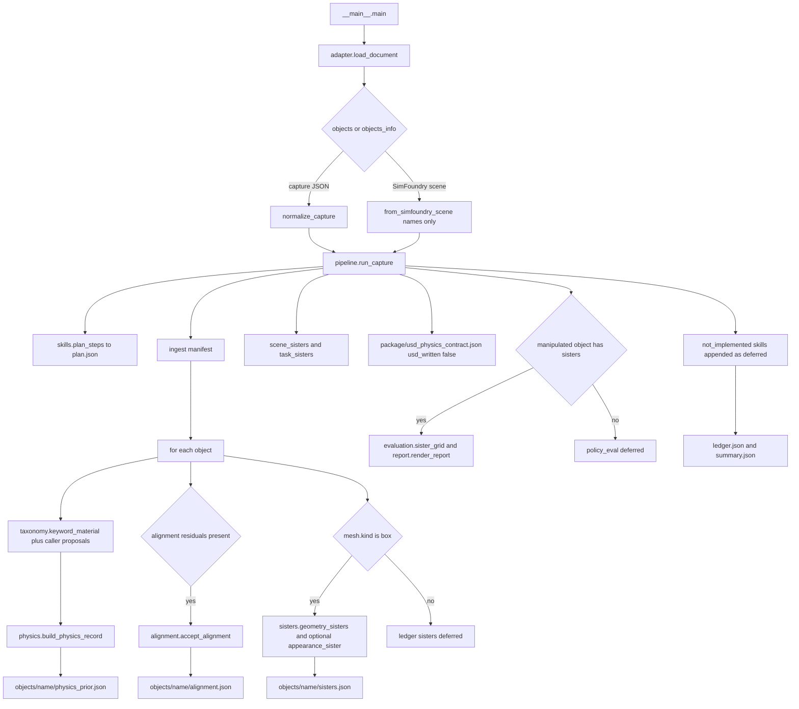

`from_simfoundry_scene` sets `movable: true` on every name, picks the first name as the manipulated object and the last as the target, and writes a template instruction. Sister geometry is deferred because that JSON has no box size. The ledger reason is "No box mesh on this object."

A skill in `LATER_SKILLS` is still listed on the plan, with status `not_implemented`, and the ledger records `deferred` plus the skill's reason. `SCENEAGENT-ALIGN-SCENE` is `gate_only`. `SCENEAGENT-INSPECT-ISAAC` is `stage_opened`: the skill table records that Isaac opened `phase1_place.usda` on the Quebec host, and `fix_report_from_model` is false.

### 4.2 Video and Fruits path

`python -m sceneagent <file.mp4> --out <dir>` does not enter `run_capture`.

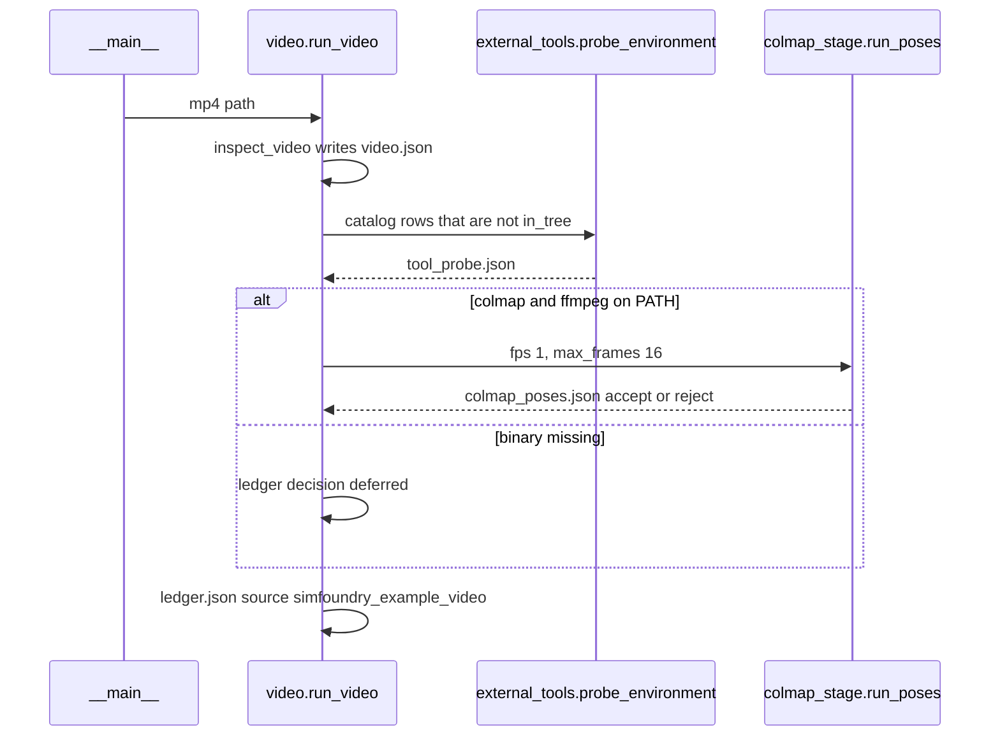

`run_poses` samples with ffmpeg `fps` and `-frames:v`, default 1 fps and 16 frames. It then runs `feature_extractor`, `sequential_matcher` with overlap 5, and `mapper`. COLMAP 4 uses `FeatureExtraction.use_gpu`. COLMAP 3 uses `SiftExtraction.use_gpu` and `--log_to_stderr`. The function returns before any splat is trained. `video.json` sets `reconstruction` to `colmap` only when poses succeed, and to `not_run` when the header was read and COLMAP did not run.

The Fruits agent loop is a different process. It assumes COLMAP, the splat, SAM masks, the feature vectors, association JSON, and a USDA already exist on disk, and it does not retrain them. `fruits_agent.PLAN_PROMPT` says that. `run_fruits` asks Gemini for a plan, `parse_plan` drops unknown step ids, and an empty parse falls back to `default_plan()`, which is `ALLOWED_STEPS` in order:

`material_vote`, `mujoco_load`, `sam3d`, `partsam`, `isaac_inspector`, `icp`, `isaac_mesh`, `mujoco_mesh`, `cubepart`, `articulate`.

```mermaid
sequenceDiagram
  participant Run as fruits_agent.run_fruits
  participant Gem as gemini_client
  participant Loop as agent_loop.run_agent_loop
  participant Tool as make_tools
  Run->>Gem: PLAN_PROMPT
  Gem-->>Run: text
  Run->>Run: parse_plan then order_plan
  Run->>Loop: tools and steps
  loop each allowed step
    Loop->>Tool: step callable or no tool registered
    alt ok
      Loop->>Loop: manifest and ledger accept
    else reject and step_repair exists
      Loop->>Tool: repair callable
      Loop->>Loop: second manifest and ledger line
    else reject and no repair
      Loop->>Loop: one reject line
  end
```

`make_tools` registers `material_vote`, `mujoco_load`, `mujoco_load_repair`, `sam3d`, `partsam`, and `isaac_inspector`. A planned step outside that set, including `icp` and `articulate`, is recorded as reject with reason `no tool registered`. That reject is the loop's behavior. Hosts that ran ICP, PartSAM, or Articulate Anything recorded those results through `agent_loop.append_step`, which adds one manifest and one ledger line without rewriting the plan. The files those runs produced are listed in `docs/GAP_MATRIX.md`. They are not produced by `make_tools`.

Tool behavior inside `make_tools`:

- `material_vote` sends `VOTE_PROMPT` plus the frame bytes. The vote file is accepted when `parse_material_class` finds a published class and HTTP status is 200.
- `mujoco_load` loads the USDA path. USDA is not MJCF, so this call is the expected rejection. `mujoco_load_repair` writes an MJCF with `mjcf_contract.write_physics_mjcf` and accepts it only after `MjModel.from_xml_path` loads and `mj_step` runs, default 30 steps.
- `sam3d` rejects when free space is under 25 GB, or when the weight byte count plus 5 GB does not fit, or when `start_sam3d` was not passed. It accepts only when `start_sam3d` returns a mesh path that exists and is non-empty.
- `partsam` rejects when the SAM 3D mesh file is absent, and rejects with "PartSAM weights were not run in this loop" when the mesh exists. The function does not launch PartSAM.
- `isaac_inspector` returns a reject whose reason distinguishes the empty-stage smoke from opening a Fruits scene.

`consider_repair` never inserts a pose. If the repair result has no `pose` key, the detail records `pose: null` and the note "No pose was supplied by the repair tool. None was invented."

### 4.3 Physics-prior train and apply

The network is two tanh hidden layers of width 32 and a linear head. `w_out` is `(32, 33)`. Input width is 912: DINOv2 ViT-S/14 at indices 0–383, OpenCLIP ViT-B-16 at 384–895, and the 16 geometry names in `mlp.contract.GEOMETRY_NAMES` at 896–911. Outputs are material logits 0–9, body logits 10–15, collision logits 16–23, `log_mass` at 24, `log_density` at 25, `rigidity` at 26, `deformability` at 27, and unnamed slots 28–32.

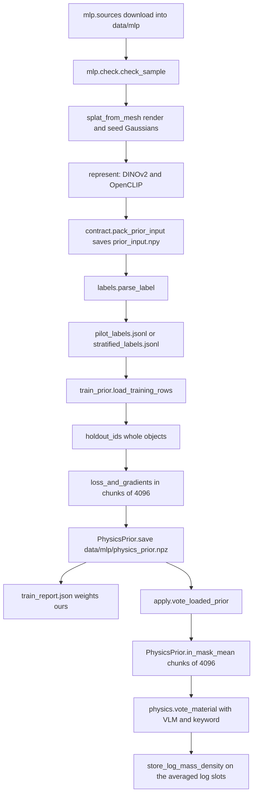

`load_training_rows` reads `pilot_labels.jsonl` first, then `stratified_labels.jsonl`. A row is kept when `status` is `ok`, the object id is new, and `prior_input` points at a file whose array is rank-2 with width 912. `holdout_ids` always holds out `002_master_chef_can`, `Weisshai_Great_White_Shark`, and `B079TXJCR5` when they are present, plus a stable SHA-256 fraction of the other ids at rate 0.12. An id is never in both splits.

`train_and_report` stops before any gradient step when `labels_should_stop` returns a reason, when any of YCB, GSO, or ABO has fewer than 20 labels, or when the split has fewer than 10 train rows or fewer than 3 holdout rows. Defaults are 30 epochs, learning rate `1e-3`, seed 0. The report records `weights: "ours"`, `section: "3.4"`, the split sizes, and `w_out_shape: [32, 33]`.

`vote_loaded_prior` checks `w_out` is `(32, 33)` and that the taxonomy lengths are 10, 6, and 8. It averages the raw 33-d outputs of the in-mask rows, including the logits. Averaging the 912 inputs and running the MLP once is a different function, and the code does not do that. `log_mass` and `log_density` are written with `store_log_mass_density`. If the resulting record also has `mass_kg` or `density_kg_m3`, the function raises. The keyword proposal is whatever the caller passes. This function does not read `_KEYWORD_RULES`.

`PhysicsPrior.load` requires `n_materials`, `n_body`, `n_collision`, `n_numeric`, the six weight arrays, and the three name arrays. `n_materials == 8` or an 8-long material list raises "refuse an old 8-class npz". Names must match `taxonomy` order.

## 5. Data contracts

These are the records that cross a module boundary. Fields below are the ones the writers set.

### 5.1 Phase-1 plan, manifest, ledger

`plan.json` from `run_capture`:

- `scene_name`, `source` (`sceneagent_capture` or `simfoundry_objects_info`), `steps` from `plan_steps`.
- Each step has `skill` and `status`. Status values used by the code are `implemented_phase1`, `gate_only`, `stage_opened`, and `not_implemented`. Gate and later steps also carry `reason`. The Isaac step carries `fix_report_from_model: false`.

Ingest manifest at `steps/SCENEAGENT-INGEST-DATA/manifest.json`:

- `skill`, `input_format` (`sceneagent_capture_v1`), `source`, `n_objects`.
- `limitation`: "Phase 1 reads JSON. It does not run COLMAP, splatfacto, or SAM."

`ledger.json` from `run_capture`:

- `scene_name`, `entries`.
- An entry has `item`, `decision` (`accept` or `deferred`), and usually `skill`.
- Physics entries add `material_class`. Alignment entries add `accepted`. Sister entries add `n` and `n_rejected`. Package adds `usd_written: false`. Policy adds `policy: scripted_geometric_place` and `learned_policy_ran: false`.
- Deferred sisters and a deferred policy include `reason`.

`summary.json`: `scene_name`, `out_dir`, `n_objects`, `n_sister_rows`, `grid_written`, `materials` mapping object name to class.

`video.run_video` writes a different ledger: `scene_name` is the file stem, `source` is `simfoundry_example_video`, and `entries` are the video accept (`bytes`, `duration_s`) plus one COLMAP entry (`accept` with `frames`, `model_dir`, `use_gpu`; `reject` with `failed_step`; or `deferred` with `reason`).

### 5.2 Section 3.1 loop plan, manifest, ledger

`agent_loop.run_agent_loop` overwrites `plan.json` in its own output directory:

- `section: "3.1"`.
- `steps`: `{id, section}` for each allowed id. Section strings are `3.4`, `3.7`, `3.3`, or `3.1` as in `STEP_SECTION`.

`manifests/<step>-<attempt>.json`:

- `step`, `section`, `attempt`, `ok`, `artifact`, `reason`, `detail`.

Ledger entry from `_entry`:

- `item`, `section`, `decision` (`accept` when `ok` else `reject`), `attempt`, `repair`, `skill`, `artifact`, `reason`.
- Detail keys copied when present: `model_id`, `paper_model_id`, `http_status`, `paper_http_status`, `material_class`, `used_paper_model`.

`append_step` reads an existing ledger or starts `{section: "3.1", entries: []}`, numbers the attempt from prior lines with the same `item`, and appends. It does not rewrite `plan.json`.

These three ledgers are not one schema. Each entry point owns the directory it was given.

### 5.3 Physics vote

`build_physics_record` returns:

- `object`, `material_class` (a class name, or `null` on a tie), `material_scores`, `material_sources`.
- Each source has `source`, `class`, `weight`, `weight_after_unknown_scale`. Unknown class multiplies the weight by `0.4`.
- `body_type`, `body_type_source` (`deformability_at_least_0.65`, `explicit_proposal`, or `unresolved`).
- `collision_primitive`.
- `friction_static`, `friction_dynamic`, `restitution`, `mass_kg`, `log_mass`, `density_kg_m3`, `log_density`, `rigidity`, `deformability`. Missing numeric keys stay null.
- `soft_body_threshold: 0.65`.
- `unpublished_class_lookups`: `youngs_modulus`, `poisson_ratio`, `rendering_material`.
- `note` stating the values are a provisional prior.

`section34.equation2_vote` returns `equation: "2"`, `unknown_scale`, `object`, `material_class`, `scores`, `sources`, `physics_prior` (`absent` or `present`), `claimed_mlp`, and `class_is_mlp`. Keyword weight basis text says the fixed weight is `taxonomy.DEFAULT_KEYWORD_WEIGHT` (1.0) and that the paper does not publish that number. A VLM class with no confidence uses weight 1.0 with basis `fixed_1_because_the_paper_does_not_publish_a_VLM_confidence`.

`apply.vote_loaded_prior` returns `proposal` (`source: physics_prior`, `class`, `weight`), `decoded` (material, body, collision, log mass, log density, rigidity, deformability, weight), `winner`, `scores`, `record`, and `mean`.

### 5.4 USD contract and the two simulator files

`package/usd_physics_contract.json` from `run_capture`:

- `format: sceneagent_usd_physics_contract_v1`, `usd_written: false`, `targets: ["Isaac Lab", "MuJoCo", "Unreal Engine"]`.
- `note` says phase 1 does not emit `.usd` or `.usdz` and does not load those simulators.
- `objects[]`: `name`, `rigid_body`, `mass_kg`, `friction_static`, `friction_dynamic`, `restitution`, `density_kg_m3`, `body_type`, `body_type_source`, `collision_approximation`, `material_class`, `rigidity`, `deformability`, `unpublished_class_lookups`.
- A missing body type becomes `dynamic rigid` with source `export_default_rigid_for_movable` when the object is movable, and `static rigid` with source `export_default_static_for_fixed` otherwise.

`write_physics_usda` emits `#usda 1.0`, `metersPerUnit = 1`, `upAxis = "Z"`, and one Xform per object with `PhysicsRigidBodyAPI`, `PhysicsMassAPI`, and `PhysicsCollisionAPI`. Null floats are comments of the form `# <name> is null in the contract`. Custom strings are `sceneagent:body_type`, `sceneagent:collision`, and `sceneagent:material_class`.

### 5.5 Alignment and ICP

`accept_alignment` without a threshold map returns `decision: undecided`, `accepted: false`, `missing`, `gate: null`, and a reason that fixed thresholds exist and are not published.

With `ours_iteration_1` or the dict from `ours_iteration1_thresholds`, the result is `decision` `accept` or `reject`, `accepted`, `failed`, `residuals`, `gate: ours_iteration_1`, `paper_published: false`, `note`, and `constants`. A missing silhouette fails that gate. The constants are `normalized_median` max 0.05, `p90` max 0.25, `coverage` min 0.5, `silhouette` min 0.5.

`measure_residuals` returns `normalized_median` (median nearest distance divided by target RMS), `p90`, `median`, `p90_inlier`, `median_inlier`, `normalizer`, `normalizer_definition`, `coverage`, `coverage_definition`, `silhouette: null`, `thresholds_published: false`. Coverage is the fraction of target points chosen by at least one trimmed inlier. The function does not accept or reject.

`trimmed_similarity_icp` also returns `scale`, `rotation`, `translation`, `rotation_seed_index`, `trim_keep`, `iterations`, `inlier_count`, `source_count`, `target_count`, and the aligned points. Rotation seeds are the identity and quarter-turns about the coordinate axes, because the stored SAM 3D rotation vector is absent. Those seeds are not acceptance thresholds.

### 5.6 Sisters and the place grid

A geometry sister from `check_sister`, extended by `geometry_sisters`, includes `extent_m`, `volume_m3`, `volume_ratio`, `fits_target`, `graspable`, `accepted`, `reasons`, `gates` (`grasp_min_extent_m` 0.005, `volume_ratio_band` `[0.5, 1.5]`, `published_in_paper: false`), plus `name`, `kind` (`bounded_axis_scale` or `procedural_texture`), `scale`, and `texture` (`hue_degrees`, `mottle`, `speckle`, `noise`, `geometry_unchanged`, `source`).

Default length scales are `(0.95, 1.05)`. The sister module says that pair is the website grid's geometry axis, and that the paper does not publish the deformation bounds. `pipeline` uses the capture's `evaluation.length_scales` when present.

`scene_sisters` returns a list of `{relation, anchor_xy_m, object_xy_m, gap_m}` for `left_of`, `right_of`, `behind`, and `in_front_of`. `task_sisters` returns three instructions, the capture string with `source: capture` and two templates with `source: phase1_template`, each with `goal: inside`.

`sister_grid` returns `task: place_inside`, `policy: scripted_geometric_place`, `not_a_learned_policy: true`, `lighting` (the nine names in `LIGHTING_SETUPS`), `lighting_simulated: false`, and `rows`. Each row has `sister`, `kind`, `accepted_for_training`, `reasons`, `trials`, and `cells` keyed by lighting name. Each cell has `successes`, `trials`, `rate`, `wilson95`, `lighting_simulated: false`, `policy`, and `sister_accepted`. `pipeline` adds `scene_name` and `instruction` before writing `evaluation/sister_grid.json`.

`single_rollout_place` is the one-rollout record: `status: partial`, `not_a_ten_trial_rate: true`, `rate_reported: false`, `cells_ran: false`, one `trial` with `containment_published: false`, and `wilson95_one_trial` on 0 or 1 success out of 1.

### 5.7 Prior npz and prior_input

`prior_input.npy` is float32, shape `(N, 912)`, finite, `N >= 1`. `geometry_from_ply` requires the ply properties in `REQUIRED_PLY_PROPERTIES`. `log_volume` and `anisotropy` are derived from the three log-scales. Rows that are not finite are counted in `dropped` and omitted.

`physics_prior.npz` fields `PhysicsPrior.load` requires:

- `n_materials`, `n_body`, `n_collision`, `n_numeric`
- `w1` `(912, 32)`, `b1` `(32,)`, `w2` `(32, 32)`, `b2` `(32,)`, `w_out` `(32, 33)`, `b_out` `(33,)`
- `materials`, `body_types`, `collision_primitives` in taxonomy order

`train_report.json` fields set by `train_and_report` include `checkpoint`, `weights`, `section`, `n_train`, `n_holdout`, `sources`, `epochs_ran`, `train_loss_last`, `train`, `holdout`, `holdout_predictions`, `known`, `w_out_shape`, the four head counts, and the three name lists. The file is written only when training finishes. It is not a substitute for the catalog row.

## 6. Design decisions already in the code

**A separate package.** New behavior is imported from `sceneagent`. `scripts/pipeline/A_reconstruction`, `B_augmentation`, and `C_application` keep their stage contracts. A SimFoundry scene is readable as a name list. That keeps the OmniGibson path installable and testable without the Harvard tool chain, and it keeps a Harvard-shaped ledger from rewriting stage outputs.

**Association cuts are pure functions.** `association.py` holds the published constants and the predicates `centroid_threshold`, `masks_same_object`, `front_surface_limit`, `gaussian_belongs`, and `mask_cell_side_px`. The front-surface test is one-sided: depth at or in front of `z_hat + max(0.08, 0.03 * z_hat)` passes, and a center behind that limit fails. The cell side is `min(16, round(short_side / 192))`. Putting the cuts here means a unit test can lock the formula before a splat exists. Applying them to a trained splat is a caller's job. The package does not write `gaussians.json`.

**The alignment gate can reject without moving its cutoffs.** ICP measurement and acceptance are different modules. `measure_residuals` records distances and sets `thresholds_published` false. `accept_alignment` returns undecided when the caller does not supply thresholds, so a missing published number cannot become a pass. `ours_iteration_1` is an explicit label. Distance residuals fail when they exceed a max. Coverage and silhouette fail when they fall under a min or are missing. The Fruits residual embedded in `alignment.py` fails that gate on coverage and silhouette. The constants and the residual live side by side so a later change that lowers a cutoff to accept the residual is visible in review.

**TRIM_KEEP is ours.** Trimmed ICP keeps the closest 0.7 of the pairs each iteration. The module documents that overlap as this implementation's, and the residual file still does not accept the pose.

**The MLP is chunked at 4096 rows.** `PhysicsPrior.in_mask_mean` and `train_prior.loss_and_gradients` both walk the Gaussian rows in blocks of 4096, sum the outputs, and divide by the count. The training comment says the chunked mean and the summed gradient match the full-array formulas, and that a 40k-Gaussian mesh should not become one allocation. Commit `caf16b7` is that change. Chunking is a memory decision. It is not a change to the loss.

**Slots 28–32 are stored and ignored.** The head width is 33 because the paper describes nine numerical outputs and the code keeps five of them unnamed. The loss and the backward pass zero those five. `decode_mean` does not read them. Naming them would be an unpublished assignment.

**Log mass is written once.** Kilogram inputs pass through `_positive_log` inside `build_physics_record`. Network outputs are already logs, so `vote_loaded_prior` uses `store_log_mass_density` and then checks that kilograms were not also filled. A second logarithm would change the number.

**Keyword weights and grasp gates are labeled local.** `DEFAULT_KEYWORD_WEIGHT` is 1.0. `GRASP_MIN_EXTENT_M` is 0.005 m and `VOLUME_RATIO_BAND` is `(0.5, 1.5)`. Sister records set `gates.published_in_paper` false. Callers can see which numbers a reviewer is allowed to treat as paper text.

**A skip is a ledger state.** Deferred, reject, `not_implemented`, `undecided`, and `closes_section_3_3: false` are the ways a missing stage is stored. `probe_environment` and the SAM 2 and GroundingDINO hooks exist so a present binary is not confused with a finished paper block. `partsam` inside `make_tools` rejects even when a mesh file is present, because that function does not run the weights.

**USD and MJCF are different repairs.** MuJoCo does not parse USDA. The loop's registered repair writes MJCF from the same contract and accepts the artifact only after `MjModel` loads. Isaac inspection is a different skill id, `SCENEAGENT-INSPECT-ISAAC`. A MuJoCo load is `SCENEAGENT-RUN-STEP`, because figure 7 has no MuJoCo skill name. The USDA writer does not load either simulator.

**The catalog row can stay missing after a local train.** `train_and_report` writes an npz under gitignored `data/mlp/` and stamps `weights: "ours"`. `catalog.py` still has the per-Gaussian MLP at status `missing` and tool `unreleased`. The matrix is the status a reader quotes. The npz is a checkpoint this tree can load. The two facts are kept apart so a local file is not described as the authors' released weights.

**CI stays on the CPU contract.** `.github/workflows/sceneagent-ci.yml` compiles `sceneagent` and runs `pytest tests/sceneagent` with numpy and pytest. It does not install OmniGibson, CUDA, or checkpoints. `docs/SDLC.md` says a test that only asserts `True` is not a test, and that a paper metric is not a result of this repo unless this repo ran that protocol and the command is recorded.

## 7. Extension points

Remaining work is an interface to fill. Status and the next command for each block stay in `docs/GAP_MATRIX.md`. Machine notes and dependency order stay in `docs/EXPANSION_PLAN.md`. When a block changes status, `docs/SDLC.md` says to regenerate the matrix from `sceneagent.catalog.to_markdown()`.

The ordered interfaces, matching the dependency those modules already have:

1. **Posed cameras into a splat.** `colmap_stage.run_poses` still samples at 1 fps with a 16-frame cap. The canvas and `GAP_MATRIX.md` already record a separate host run of `Fruits.mp4`: 452 frames, COLMAP 4.2.1 CUDA, 452/452 registered, and a splatfacto-big checkpoint at `max-num-iterations` 30000 (`step-000029999.ckpt`). Those files were not written by `run_poses`. The 15-frame model and the 2000-step checkpoint were kept. A new capture still needs a full-rate caller inside this package before that host command is the default.
2. **Masks and features that do not decide membership.** Section 3.3 masks and the two embeddings are inputs to `association.gaussian_belongs` and to `mlp.contract.pack_prior_input`. `sam2_user` and `website_step02` are the wrong hooks for that row; both refuse to close it. The association functions are ready. They need centers, a mask, and a camera.
3. **A residual file the gate can read.** `similarity_icp.trimmed_similarity_icp` and `measure_residuals` produce the four residual kinds, with silhouette left null until a caller fills it. `accept_alignment` is the only acceptor. A published threshold map would be a new argument. Until that map exists, the honest outputs are `undecided` or an explicit `ours_iteration_1` reject. Lowering `OURS_*` constants to flip a stored residual is a behavior change, not a calibration.
4. **Plane completion, then optional LaMa.** `infill.complete_background` fits a plane when background points, colors, and a hole mask are present, and writes a rendered PNG. LaMa stays off unless `use_lama` is set. `plane_infill` returns `emitted: false` when it has nothing to inpaint. An inpainted patch is a new file, written only when LaMa is installed. The Fruits run on instance 58301075 is still open.
5. **Parts, completion, and joints as ledger steps.** `append_step` is the recording API. `make_tools` does not launch PartSAM, CubePart, or Articulate Anything. `section34` already chooses the CubePart call shape that avoids the diffusers 0.39 `QwenEmbedRope` TypeError, and `articulate_download_allowed` checks free space against the uncompressed listing plus 8 GiB. A completion mesh and a URDF become comparable when a registered tool writes the file and a later ledger line accepts or rejects a simulation review. `cubepart_status` stays an open row while no part mesh exists.
6. **Inspector frame before policy, 4D, or fracture.** `SCENEAGENT-INSPECT-ISAAC` is `stage_opened` until a coding model writes a fix report. `LATER_SKILLS` includes fracture, both 4D skills, policy autoresearch, and VLA adaptation, all `not_implemented`. The USD contract's `usd_written` flag and the rigid-only USDA writer are the export those later skills must not overload: deformables, fracture, and fluids stay outside that file. `evaluation.single_rollout_place` is the place to record one rollout; `sister_grid` is the place to record a geometric grid. Neither is a learned-policy result. A LoRA trainer is not a module in this package.
7. **Scoring after meshes exist.** `metrics.symmetric_chamfer`, `f1_at_threshold`, and the small Hungarian matcher are the scoring interface. A scene score is a new file that names its clouds and its match. The matcher as written will not score a 20-object scene. Extending it is a code change with a test, and the score file is still empty until those clouds exist.
8. **Prior status.** Applying `vote_loaded_prior` to a Fruits Gaussian set is a caller of the existing function. It does not change the catalog sentence. The row moves when `catalog.py` is edited and the matrix is regenerated, and the report field `weights` stays `ours` for any npz this trainer wrote.

`docs/DESIGN.md` still prints an older row count (4 done, 11 partial, 23 missing, 38 rows) from an earlier phase-1 snapshot. `docs/GAP_MATRIX.md` is the count `catalog.py` emits now. Read the matrix.

## 8. What this document is not

This file is the design of `sceneagent` on the SimFoundry fork, plus the reproduction plan in section 9. It is not Dual Doc 2.0, and it does not carry that plan's assumption audit, retired-target list, token totals, or episode grids. Section 10.11 is the only place this file takes protocol sentences from that document, and only after those sentences match the Harvard PDF. It is not a description of SceneagentX. The implementation to read is `C:\Users\sande\cursor\sceneagent-simfoundry\sceneagent`. Section 9 names the section 4 protocols a future score file has to match. A number becomes a result of this fork only when a command in this tree writes it and the ledger or the gap matrix names the file.

## 9. Reproduction plan

The gap review that this plan follows is the canvas "SceneAgent paper versus the SimFoundry upgrade" (`sceneagent-paper-gaps.canvas.tsx`). It has 42 rows, the same sub-blocks as `sceneagent/catalog.py`. Where that canvas and `docs/GAP_MATRIX.md` disagree, section 9.6 says which text this plan uses. Row status below is the canvas status. "This pass" on the canvas is a separate column: `fixed` means the code or a real run does that paper sentence; `still open` means the catalog artifact is not that sentence.

### 9.1 What a Harvard number is

Original SimFoundry (arXiv:2606.28276) builds a sim-ready twin from one video and then object, scene, and task cousins. Its own evaluation is Pearson correlation between sim and real, and cousin training gains. Pipelines A, B, and C are that system. Their F1 protocol is not the protocol in SceneAgent section 4.1.

SceneAgent section 4, the results this fork can later quote, is four protocols:

| Result | Protocol this plan has to hit | What this repo has today |
|---|---|---|
| Bin reconstruction | GraspClutter6D `hard/000091`. 20 YCB objects, 13 RGB views at 1920×1080. One similarity for the whole run. No object is refit for scoring. 10,000 surface points per ground-truth object. Hungarian matching uses Chamfer distance as the cost. F1 at 1 cm averages over all 20 objects, and an unmatched object scores 0. Chamfer averages over matched objects only. Tau is 1 cm. The paper's best F1 on that scene is 60.75%. SimFoundry in that comparison is 6.9% F1 and 4.29 cm Chamfer. | No bin images, no bin meshes, no score file. `docs/assets/example_videos/Fruits.mp4` is the example the package has run. |
| Kitchen reconstruction | MessyKitchens, one shared capture. Ground-truth scans are used as the benchmark ships them. One rigid transform. Scales kept. No per-object refit. 100,000 points per object, three seeds, objects weighted equally. Both metrics average over the three seeds and then over objects. SimFoundry on that kitchen is 10.21% F1 and 11.67 cm Chamfer. That pair is the kitchen. It is a different pair from 6.9% and 4.29 cm. | No kitchen capture and no kitchen score file. |
| Dynamic IoU | Section 4.2 on 4DCodeBench B_09 (130 frames, 1280×720), Z_06 (150 frames, 1280×720), and Z_12 (81 frames, 1600×900), all at 24 fps. Equation (6) compares dynamic-matter masks and excludes a thin boundary band. The paper's 99.09% figure is Gemini 4 Argon's with-skills mean on these three cases. It stays the paper's. | No 4D clip, no build script, no dynamic-IoU file. |
| Policy tables | Section 4.4 fine-tunes pi0.5 on simulation-only demonstrations. The printed LoRA split is rank 16 and alpha 16 on the Gemma-2B backbone, and rank 32 and alpha 32 on the 300M action expert. Evaluation uses checkpoint 19999. The canvas cites the paper's 40-episode cell, 57/200 in simulation and 24/50 in the real world, as an example of that table. Those counts stay the paper's. | No episode archive and no LoRA checkpoint. `evaluation.sister_grid` sets `not_a_learned_policy`. |

`Fruits.mp4` is the phase-1 and Quebec capture. It is not a row in those tables. A Fruits F1, a Fruits Chamfer, or a Fruits place rate does not move section 4.

One kitchen caveat belongs in any future kitchen file. The paper's Grok Build run produces three of the four objects and omits the knife block. On that matched three-object subset, F1 goes from 5.67% to 17.68% and Chamfer from 5.25 cm to 2.81 cm. A run that drops an object has to name the subset. It is not the four-object kitchen score, and it is not the bin score.

The phase-1 contract (`python -m sceneagent examples/phase1_place_scene.json`) writes plan, ledger, keyword vote, box sisters, and a geometric grid. It does not run COLMAP, splatfacto, or SAM. That output is the file contract. It is not a section 4 input.

### 9.2 Two paths

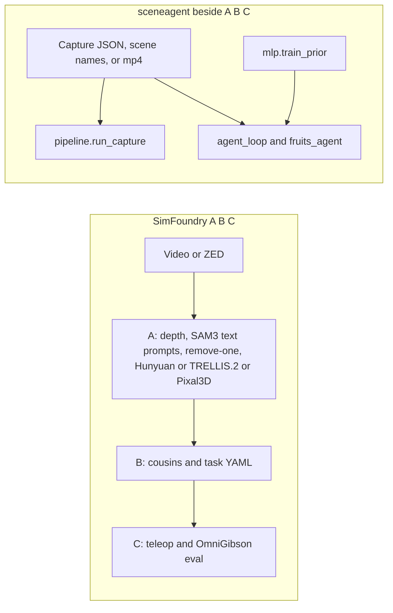

A Hunyuan or TRELLIS mesh from stage 7 stays a pipeline A mesh. `catalog.py` says those generators are not SAM 3D. Pipeline B cousins stay pipeline B. `sisters.py` does not call Meshy, and the canvas Meshy row stays missing until a Meshy image-to-3D or Meshy-6 file exists. Labeling a Hunyuan file as either of those is a false done.

### 9.3 Gates between the entry points and a quoted number

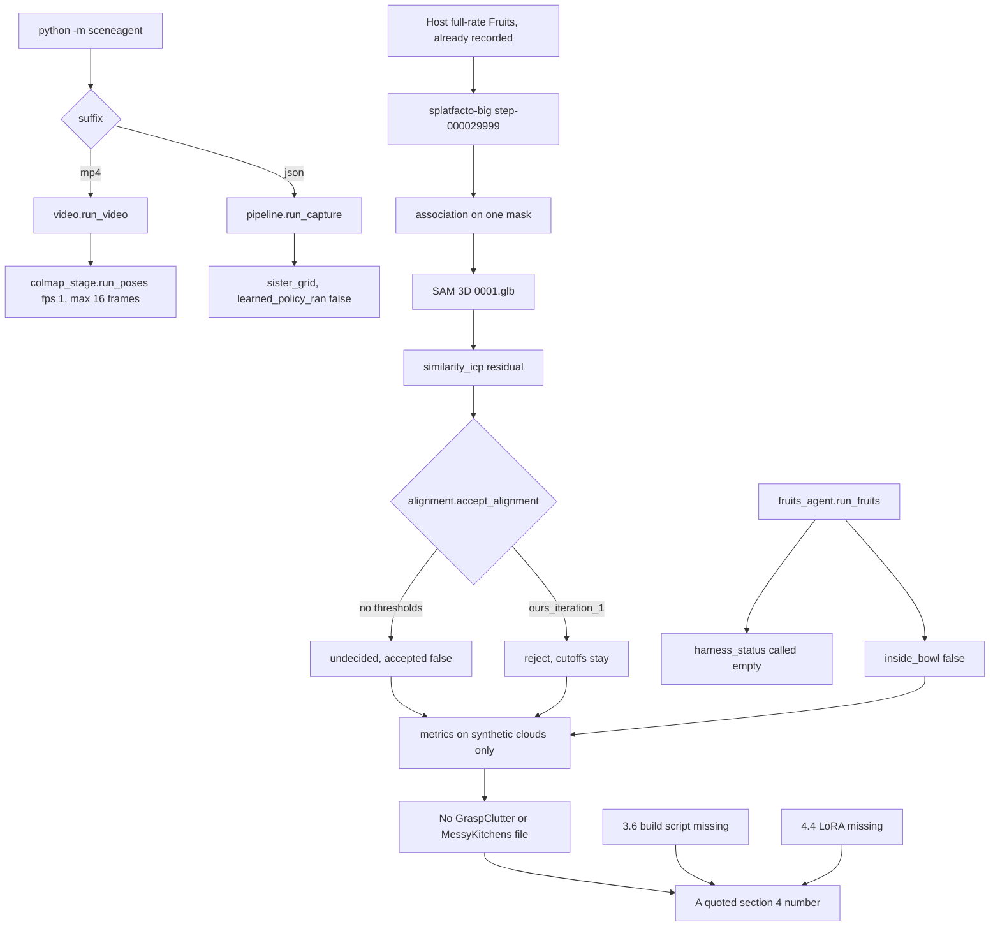

`metrics._hungarian` raises above 8 objects on a side. The bin has 20 objects. A score file for `hard/000091` needs that matcher extended, then clouds from that scene. Extending the matcher does not by itself create the number.

`ours_iteration_1` rejects the Fruits residuals the canvas records. The first residual has coverage 0.14616666666666667 and silhouette null. The full-rate residual has coverage 0.09366666666666666 and silhouette 0.17505342248569655. Both fail coverage and silhouette against minima of 0.5. The paper's four thresholds stay unpublished, so `accept_alignment` without a caller-supplied map stays `undecided`. Lowering `OURS_COVERAGE_MIN` or `OURS_SILHOUETTE_MIN` so either residual passes is a behavior change. It is not a reproduction of section 3.1.

The full-rate MuJoCo drop ended at z 0.18175340000000004 m with `inside_bowl` false. That reject stays a reject. A place success is an object that ends inside the target on the benchmark task, not a rewritten bowl test.

### 9.4 Row by row

Done rows stay as the artifact named here. Partial and missing rows name the code that exists, the file that would count as done, and the false done to avoid. Host paths are the ones the canvas and the matrix already record. They are not in this git tree.

#### 3.1 Agent loop

| Row | Status | Now | Counts as done | Do not |
|---|---|---|---|---|
| Plan, manifest, ledger | done, this pass fixed | `pipeline.run_capture` writes `plan.json`, one ingest manifest, and `ledger.json`. The Quebec loop wrote `/workspace/fruits-agent/plan.json`, one manifest per attempt, and `ledger.json`. | Those files, already produced. | Treat the file contract as the repair loop. That is the next row. Do not regenerate the phase-1 files to claim a new result. |
| Agent repair loop | done in the catalog, this pass still open | `agent_loop.run_agent_loop` and `append_step`. `fruits_agent.make_tools` registers a repair only for MuJoCo, and that repair is `mjcf_contract.write_physics_mjcf`. `harness_status` returns six names and `called: []`. `reviewer_views.write_view_manifest` names eleven files and does not draw them. | A ledger whose repair was chosen after looking at the eleven reviewer images, from a figure-5 harness. | Call catalog `done` a paper agent. The canvas records that later accepts (SAM 3D attempt 2, PartSAM attempt 2, inspector attempt 2, ICP attempt 1, isaac_mesh attempt 1, mujoco_mesh attempt 1) were appended. `make_tools` still returns failure for `partsam` and `isaac_inspector`. `gemini-2.5-flash` returned HTTP 404. `gemini-3.8-flash` returned HTTP 200 and the class wood. The current `PLAN_PROMPT` does not embed a JSON plan; an empty parse falls back to `default_plan()`. The older prompt that forced `material_vote` then `mujoco_load` is the behavior the canvas says this pass replaced. |
| Alignment acceptance gate | partial, this pass fixed as code | `alignment.accept_alignment` and `ours_iteration1_thresholds`. | A residual file whose four values pass a threshold map that is either published or explicitly labeled `ours_iteration_1`, without editing the constants to fit the file. | Invent the paper's four numbers. Mark `undecided` as accept. The canvas says `EXPANSION_PLAN`'s "Not run" is stale: `icp_residual.json` and `icp_residual_fullrate.json` exist. `TRIM_KEEP` 0.7 stays this tree's overlap. |

#### 3.2 COLMAP and splatfacto

| Row | Status | Now | Counts as done | Do not |
|---|---|---|---|---|
| COLMAP camera poses | partial, still open | `colmap_stage.run_poses`, default `fps=1`, `max_frames=16`. `ingest_assets` flags mean-RGB L1 above 30 as `ours_mean_rgb_l1_above_30`. | `model_analyzer` on a full-rate sequence whose cameras feed splatfacto, plus the paper's per-image color calibration. The host already has `/workspace/fruits-fullrate-colmap/sparse/0`: 452/452, 37004 points, mean reprojection 0.800435 px. | Close the row on the 15-frame sample (603 points, 0.867273 px, or the Texas 674 points at 0.892696 px). Those files stay. Color calibration was not run, so the row stays partial even after the 452-frame model. The in-repo cap is still 16 frames. |
| splatfacto big | done, still open as a scene | Host checkpoints `step-000001999.ckpt` (2000 iterations, preset `cull_alpha_thresh` 0.005 and `densify_grad_thresh` 0.0005) and `step-000029999.ckpt` (199655698 bytes, internal step 29999, 268015 means) from the 452-frame model. | The 30000-iteration checkpoint and a rendered view, already produced for Fruits. | Delete the 2000-step checkpoint. Call the background splat an object with parts and joints. The canvas's older line that training stopped at 2000 is superseded by the full-rate callout in the same canvas. |
| Photogrammetry, LiDAR, generated 3DGS | missing, this pass fixed as a reader | `ingest_assets` accepts an on-disk ply, obj, or las and rejects a Marble, Lyra, or HY-World URL. `colmap_ran` stays false. | One non-video asset that passes a ledger entry. | Say the reader is missing. Say a URL download happened. Video and ZED remain the only accepted captures on the Fruits run. |
| Example video metadata | partial, still open | `video.inspect_video`. Fruits is 1733022 bytes and 15.067 s. | A reconstructed scene, which is the splat row. | Treat duration as that scene. |

#### 3.3 Association and meshes

| Row | Status | Now | Counts as done | Do not |
|---|---|---|---|---|
| SAM masks | done, still open as coverage | SAM vit_h on every 10th frame of the 15-frame sample. `0001.jpg` has 33 masks. `0011.jpg` has 19. | Those two mask files, already produced. `sam2_user` does not close this row. | Rerun SAM 2 and call it the paper masker. Call two frames of a 1 fps sample a full-rate stride. `EXPANSION_PLAN`'s "SAM has not run" is stale. |
| GroundingDINO | missing, still open | `website_step02`. Status `not_run_gpu_busy` when the GPU flag is set. `weights_loaded` false. `closes_section_3_3` false. | A website-step-02 run, labeled as the website. It still does not close section 3.3. | Put GroundingDINO in place of `0001.glb`. The paper's section 3.3 does not name it. |
| OpenCLIP ViT-B-16 | done, still open as coverage | 512-d `openai` vectors for `0001.jpg` and `0011.jpg` in `/workspace/fruits-features/features.json`. | Those two crop vectors, already produced. | Call them a feature on every Gaussian, or swap in another CLIP. |
| DINOv2 ViT-S/14 | done, still open as coverage | `dinov2_vits14`, 384-d, same two crops, checkpoint already on disk. | Those two vectors, already produced. | Substitute DINOv3. Call a crop vector the per-Gaussian MLP input. |
| LangSplat-style codebook | missing | No module writes a language-Gaussian codebook. Association does not use the embeddings to assign Gaussians. | A specified feature lift, then the file it writes. | Vendor the LangSplat repo and call that the assignment test. Equation (1) remains the membership test. |
| Gaussian association cuts | done, still open as coverage | `association.gaussian_belongs` and `masks_same_object`. Host artifact `gaussians.json`: 27548 of 84993 kept on the largest mask of `0001.jpg`. 76629 projected, 48534 in the mask. Cell side 4 px. Full-rate equation (1) kept 82174 of 268015. | That JSON, already produced for one mask. | Claim multi-view grouping or camera consensus. Kappa 1 means the union; the stricter filter was not exercised. An early changelog line that called this row partial disagrees with catalog. Catalog status is the one the matrix copies. |
| SAM 3D meshes | done, still open as coverage | Host `0001.glb`, 3238692 bytes, max side 720, plus `0001_gaussian.ply` at 10153632 bytes, render, and overlay. Ledger `sam3d` attempt 2 accepted. | That mesh, already produced. | Label a Hunyuan, TRELLIS.2, or Pixal3D mesh as this file. Start ICP from a SAM 3D rotation vector the export did not store. The plan table that still says "Meshes: Missing" is stale. |
| Trimmed similarity ICP | partial, still open | `similarity_icp.trimmed_similarity_icp`. First residual: scale 3.0328311154811303, translation `[-0.7755219189905452, 2.157819477783848, -0.28589919065664093]`, median 0.04999262711481225. Ledger `icp` attempt 1 accepted the file. Full-rate residual scale 1.6509326636538109. Ledger `icp` attempt 2 rejected it under `ours_iteration_1`. | A residual initialized from the stored SAM 3D pose, with silhouette filled, and the section 3.1 gate either undecided or an explicit ours reject. The file accept is not the pose accept. | Lower cutoffs so attempt 2 becomes an accept. Treat rotation seeds as the paper's initial pose. `GAP_MATRIX` matches catalog: partial. |
| LaMa background infill | partial | `infill.fit_plane` and `complete_background` fit a plane on CPU and fill the hole from nearby plane-surface colors. LaMa defaults off and is not imported when off. The ledger records method `plane` or `lama`, inputs, and outputs. Weights are not installed. The Fruits background on instance 58301075 has not been run. A counts-only placeholder is still not a completed background. | The Fruits plane-completion image, then an inpaint file only when LaMa is installed. | Forge a PNG. Call the placeholder a completed background. Make LaMa required. |

#### 3.4 Materials, parts, articulation

| Row | Status | Now | Counts as done | Do not |
|---|---|---|---|---|
| Material vote | done, still open as a Fruits vote | `physics.vote_material` and `section34.equation2_vote`. Unknown scale 0.4. Keyword dictionary is `taxonomy._KEYWORD_RULES`. Modulus fields stay null. | The formula, already in the phase-1 contract. | Say equation (2) ran as prior plus VLM plus keywords on Fruits Gaussians. The live class on that capture is the VLM row. A missing prior stays `claimed_mlp: false`. |
| Per-Gaussian MLP | missing | `mlp/contract.py` packs `(N, 912)`. `mlp/prior.py` is width 32 with a 33-d head. `mlp/train_prior.py` can write `data/mlp/physics_prior.npz` with `weights: "ours"`. `catalog.py` still says status `missing` and "Do not train a stand-in and call it their prior." | A catalog edit, after a real training report, that still labels the checkpoint as ours. Harvard's weights are not released, so this row does not become "their prior." | Quote a gitignored npz as the paper network. The canvas block text says the 16 geometry features are not an interface. That sentence is behind `caf16b7`. The status both the canvas and the matrix assign is still `missing`. Follow the status. Follow the code for what the tree contains. |
| VLM material proposal | partial, this pass fixed as a recorded call | `gemini_client` tries `gemini-2.5-flash`, stores the 404, and does not relabel the fallback as 2.5. `material_vote.json` is class wood from `gemini-3.8-flash`. A later properties call on `0001_crop.jpg` returned plastic, friction 0.4, mass 0.05 kg, density 950. `request_audit` does not call unless `live=True`. One live audit returned "The provisional class stands." | A vote that includes a prior, a VLM class, and a keyword class, then the audit. The wood file and the plastic properties file already exist and stay labeled `gemini-3.8-flash`. | Call the fallback Gemini 2.5 Flash. Call one image class a per-Gaussian prior. Drop the historical 404. |
| PartSAM | done, this pass fixed | `/workspace/PartSAM/evaluation/results/0001.ply`, 3723721 bytes. 1168 masks at 0.65, 15 after NMS. 161892 faces, so `use_graph_cut` was false. Batch size 4. Apex was not built; `FusedLayerNorm` fell back to `torch.nn.LayerNorm` and the checkpoint loaded. Ledger attempt 2 accepted. | That ply, already produced. | Rerun PartSAM on the same mesh to change the count. The part VLM is the CubePart row. |
| CubePart | missing | Weights on disk. Attempt 2 is the diffusers 0.39 `QwenEmbedRope` TypeError: repo call `pos_embed(img_shapes, txt_seq_lens, device=...)` against `forward(video_fhw, device)`. No part mesh. The part VLM, `gemini-3.8-flash` after a 2.5 404, saw the 15 largest face-color parts of a ply the catalog says has 19 face colors, set `completion_needed` false, and described a fully captured table. Ledger `cubepart` attempt 3 rejected. `section34.choose_qwen_embed_rope_call` only picks the call shape. | A part mesh appended after a VLM says completion is needed, plus a ledger line. | Start inference after `completion_needed` false and call that the marker tip. Treat attempt 1's disk reject as the whole story. The canvas block said the VLM never looked and that catalog omitted attempt 2. The later canvas section and `GAP_MATRIX.md` record the VLM and attempt 2. This plan follows that later text. Status stays missing because no part mesh exists. |
| Articulate Anything | partial | Two URDFs, each 13408 bytes, robot name table, PartNet 25959, links `base`, `furniture_body`, `wheel`, `wheel_2`, `wheel_3`, `wheel_4`, five fixed joints. `gemini-1.5-flash-latest` returned 404. `gemini-3.8-flash` labeled the clip as a table. Attempt 2 accepted the first URDF. Attempts 3 and 4 rejected both table URDFs for the fruit and kept the files. CoTracker wrote `aug_Fruits.mp4` (13307277 bytes) after `cotracker2.pth` (204396415 bytes). `sapien_simulate.py` exited 139. Joint actor `IndexError`. `feedback_score` -1. | A URDF whose links are the PartSAM parts of this object, then a simulation review the ledger accepts. | Call table 25959 a fruit joint set. The tool has no input for `0001.glb` or the 15 parts. Stage 9 of pipeline A is not this system. The matrix header was regenerated after that lag. The working tally moved again when the LaMa row became partial: 17 done, 12 partial, 13 missing. |

#### 3.5 Fracture

| Row | Status | Now | Counts as done | Do not |
|---|---|---|---|---|
| Warp, Blast, Newton | missing | `skills.LATER_SKILLS` lists `SCENEAGENT-SIMULATE-FRACTURE` as `not_implemented`. The USDA writer has no fracture fields. | An authored example scene and its run log, outside the USD contract. | Copy the paper's parchment or ceramic numbers into that log. Put fracture in `usd_physics_contract.json`. |

#### 3.6 4D

| Row | Status | Now | Counts as done | Do not |
|---|---|---|---|---|
| Dynamic scene and build script | missing | No 4D module. Figure 4 charts the 4D token stages S0 through S6, and its S3 is continuum, MPM, and fluid. The canvas 4D chart S0–S6 is entirely missing. | A build script that regenerates frames, meshes, and trajectories for B_09, Z_06, and Z_12 without reading the video, plus a dynamic-IoU file this script measured. | Report 99.09% as this repo's score. Skip the block and call the skip a pass. |

#### 3.7 Export, simulators, viewer

| Row | Status | Now | Counts as done | Do not |
|---|---|---|---|---|
| USD physics contract | done | `usd_contract.write_physics_usda`. Isaac opened `/workspace/phase1_place.usda`: `opened=True`, prims `/World`, `/World/box`, `/World/bowl`. Null mass or density stays a comment. Phase-1 JSON still has `usd_written: false`. | That open, already produced, for the primitive contract. | Call the box and bowl the reconstructed fruit. The paper says OpenUSD. The site says USDZ. This tree has no USDZ row. Deformables, fracture, and fluids stay out of the file. |
| Isaac Lab empty stage | done | `EMPTY_STAGE_OK` in `/workspace/empty-stage-result.txt`. Isaac Sim `5.1.0-rc.19`, Isaac Lab v2.3.2, package `isaaclab` 0.54.2. Host glibc 2.31; the kit Python uses the jammy 2.35 loader. `python.sh` on host glibc still segfaults. | That empty-stage file. | Treat it as the Fruits inspector. |
| Isaac inspector | done | Ledger `isaac_inspector` attempt 2 accepted `isaac_inspector.txt` for the same primitive stage. `skills.plan_steps` sets `SCENEAGENT-INSPECT-ISAAC` to `stage_opened` and `fix_report_from_model` false. `EXPANSION_PLAN`'s "Not run" is stale. | The primitive open, already produced. | Say a coding model wrote a fix report. |
| Aligned mesh USDA | done | `/workspace/phase1_aligned_mesh.usda`, 5339577 bytes. Prims `/World`, `/World/aligned_mesh`, `/World/aligned_mesh/geometry`, `/World/bowl`. The canvas run record counts 8095 faces. Ledger `isaac_mesh` attempt 1 accepted. | That open, already produced. | Claim section 3.1 accepted the pose. The gate is still undecided or an ours reject. The export is ahead of the gate. |
| MuJoCo | done | MuJoCo 3.17.0 rejected the USDA. `phase1_place.xml` loaded (nbody 3, nq 7, 30 steps). `phase1_place_mesh.xml` is the convex hull, 327 vertices and 650 faces, fit to the contract box longest side 0.096 m. End z 0.18175340000000004 m. The full-rate hull missed the same way. `inside_bowl` false. Bowl null mass uses loader density 1000. | The load, already produced. | Call the load a place success, or a success rate. An early changelog line that left the row missing is stale. |
| Unreal Engine | missing | No loader. | A person-confirmed USD load, after the file exists. | Name the target and call it tested. |
| Three.js viewer | partial | `scripts/interactive/light_editor` is the SimFoundry editor. It was not pointed at `phase1_place.usda` or the aligned mesh. | That editor showing this capture's mesh, with the figure 14 controls the paper lists. | Add a second viewer. Call the existing editor the paper viewer on this capture. |
| Experiment grid page | partial | `report.render_report` and `place_grid.json`. One MuJoCo rollout. Wilson on 0 of 1 is 0 to 0.7934506856227626. `lighting_simulated` false. | Ten trials per cell, which Figure 14 prints. The nine names in `LIGHTING_SETUPS` are this tree's website columns. A Wilson interval on a cell is this tree's summary. | Call the one-cell file figure 14, or copy the site's pi0.5 cells. |

#### 3.8 Sisters

| Row | Status | Now | Counts as done | Do not |
|---|---|---|---|---|
| Model-free mesh and texture | done | `sisters.geometry_sisters` on the contract box and bowl. `box.json` and `bowl.json`. The length +5% box does not fit the bowl. Grasp band is `GRASP_MIN_EXTENT_M` 0.005 and volume ratio `(0.5, 1.5)`, with `published_in_paper: false`. | Those two primitive files, already produced. | Bake that result onto `0001.glb` and call it the same run. Call Meshy. |
| Meshy generative sisters | missing | No Meshy call and no Gemini 3 Pro Image edit. Pipeline B remains Hunyuan and Gemini cousins. | A Meshy image-to-3D mesh or a Meshy-6 retexture whose geometry and UVs are unchanged. | Label Hunyuan as Meshy. |
| Scene and task sisters | partial | `scene_sisters` writes four horizontal offsets. `task_sisters` writes three templates. | Layouts sampled around a task anchor in the simulator, and instructions drawn as section 3.10 describes. | Call the templates the figure 7 skills, or a failure-driven sister from a real-robot recording. |

#### 3.9 Hybrid scenes

| Row | Status | Now | Counts as done | Do not |
|---|---|---|---|---|
| Captured object in an artist scene | missing | The aligned mesh exists and was not inserted into an artist scene. The light editor can insert props. | A saved scene that contains that mesh inside an artist environment. | Claim the paper's kitchen, warehouse, lab, data-center, or studio videos were rebuilt. |

#### 3.10 Expert and the place grid

| Row | Status | Now | Counts as done | Do not |
|---|---|---|---|---|
| Scripted place check | partial | `evaluation.score_trials` is a reach disc around the anchor. `single_rollout_place` is one qpos. The Quebec drop and the full-rate drop both end outside the bowl. No robot, no eight-phase controller, no depth composite over the splat. | Episodes whose object ends inside the target, with the eight phases and composited observations, on the task being scored. | Call the geometric disc, or the missed drop, that expert. `inside_bowl: false` stays false. |
| Wilson interval | done | `metrics.wilson_interval` on the 0-of-1 trial. | The function, already used. | Call 0 of 1 a ten-trial cell, or a place success. |
| pi0 / pi0.5 fine-tune | missing | No module trains LoRA. `SCENEAGENT-ADAPT-VLA-POLICIES` is `not_implemented`. | A checkpoint and counts this repo measured, written after the inspector fix report exists. | Copy the eggplant table. Start from the canvas site note about a 10,000-episode finetune. Section 4.4 is pi0.5. |

#### Section 4

| Row | Status | Now | Counts as done | Do not |
|---|---|---|---|---|
| F1 at 1 cm and Chamfer | partial | `metrics.symmetric_chamfer` and `f1_at_threshold` with `TAU_1CM_M` 0.01. Tested on synthetic clouds. `metrics._hungarian` matches any object count: `_assign_every_row` covers 9 and 20 (`test_nine_objects_are_matched_instead_of_raising`, `test_twenty_objects_use_the_planted_matching`) and the shorter side (`test_more_ground_truth_than_predictions`); at most `_ENUMERATION_MAX` (8) with a column per row stays `_enumerate_assignment` (`test_at_most_eight_matches_phase1_enumeration`). A non-finite cost on the Kuhn-Munkres path still raises (`test_non_finite_cost_past_the_enumerator_raises`). | A score file that names MessyKitchens or the bin, the point counts, the alignment rule, and the match. | Score Fruits and file it here. Treat SimFoundry's own Pearson or cousin gains as this F1. |
| GraspClutter6D hard/000091 | missing | This scene has not been started. Figure 6 labels stage S3 SplatGraph clustering. Section 3.3 grouping is `association.masks_same_object`, and that function has not been run on the bin. Stages S0 and S7 have no bin run. S1, S2, S4, S5, and S6 are partial on Fruits only. | The bin protocol above, after meshes of that scene exist. 60.75% and 6.9% / 4.29 cm stay the paper's comparison. | Enter `0001.glb` in that table. |
| Official release | missing | This tree is the SimFoundry fork plus `sceneagent`. The paper's code, processed scenes, and example objects are a separate release. Section 4.3 has no reproduction phase. | That release, if it ships, as an upstream. It is not a substitute for the score files above. | Point the reproduction at another application checkout. |

### 9.5 Order that unblocks a comparable number

Only rows the canvas still marks partial or missing are in this sequence. Done artifacts in section 9.4 stay on disk.

1. Obtain GraspClutter6D `hard/000091` and the MessyKitchens shared capture. They are not in the repo. Fruits stays the example, off to the side of the score file.
2. Run the sceneagent capture path on those inputs. Use a full-rate COLMAP invocation. `run_poses` will otherwise stop at 16 frames. Train splatfacto-big. Mask with SAM on the paper stride. Apply `association.gaussian_belongs`. Build the mesh with SAM 3D. Write ICP residuals. Leave `accept_alignment` undecided unless the caller passes `ours_iteration_1`, and do not edit those four constants to obtain an accept.
3. Extend `metrics._hungarian` so the 20-object bin can be matched, and keep `metrics.score_reconstruction` as that file's aggregator. Write the kitchen file with the seed-then-object average in section 10.8. That file does not call the bin matcher. A dropped object, including a knife-block omission, is named in the kitchen file.
4. Keep the conversion rows honest while that score is computed. Color calibration, a per-Gaussian feature file, plane completion, and a Harvard MLP are still partial or missing. A score file can exist while those rows stay open. The score file does not close them. `vote_loaded_prior` may run on an ours npz. The catalog MLP row stays missing, and the report field stays `weights: "ours"`.
5. Dynamic IoU is next only after a section 3.6 build script exists for B_09, Z_06, and Z_12. The measured IoU is the number. 99.09% is not copied.
6. Policy is after an inspector line whose `fix_report_from_model` is true. `stage_opened` on the Fruits USDA is not that line. The scripted expert then has to put the object inside the target. The LoRA run writes this repo's counts. The printed eggplant table stays the paper's. `inside_bowl: false` on the Fruits hull is not a step in that run.
7. Unreal, hybrid insertion, Meshy, and fracture stay behind that inspection frame. They do not unblock the first F1 file. Each still has the done condition in section 9.4, and none of them is closed by skipping it.

### 9.6 Canvas, matrix, and code

This plan uses the canvas for what the gap review decided, and `catalog.py` / `GAP_MATRIX.md` plus the modules in sections 3–5 for what the repo contains.

- The matrix header used to print 17 done, 10 partial, 15 missing while the Articulate Anything row was already partial. That lag was closed at 17 / 11 / 14, then the LaMa row moved to partial. `catalog.py` and `GAP_MATRIX.md` now count 17 done, 12 partial, 13 missing. Section 9.4 uses the row.
- The canvas MLP block says there is no network and that the 16 geometric features are not an interface. `caf16b7` adds `mlp/prior.py`, `mlp/contract.py`, and `mlp/train_prior.py`. The catalog row was not updated and still says `missing`. Both the decision (missing, and a local npz is not Harvard's) and the code (the trainer exists) are kept.
- The canvas CubePart block says the part VLM never ran and that catalog omits attempt 2. The later canvas section and the matrix record the VLM reply `completion_needed: false`, the TypeError on attempt 2, and the reject on attempt 3. No part mesh. Status stays missing.
- A canvas nuance bullet still says splatfacto stopped at 2000 iterations and that COLMAP was the 15-frame sample. The same canvas's full-rate callout, and the COLMAP and splatfacto `ran` fields, record 452 frames and `step-000029999.ckpt`. Those are the runs this plan keeps. The 15-frame and 2000-step files stay beside them. Color calibration is still undone.
- The canvas process note says `main` was eight commits ahead of `origin/main` with the section 3.1–3.4 files uncommitted. On this checkout, `main` and `sceneagent/sections-3.1-3.4` both match `origin` at `caf16b7`, with one untracked file `tools/_tmp_qc_art_inst_status.sh`. The reproduction does not treat the package as uncommitted. The CI job still installs only numpy and pytest, so it still cannot prove COLMAP, Isaac, or CubePart.
- `DESIGN.md` still opens with an older 4 / 11 / 23 / 38 count. `EXPANSION_PLAN.md` still says the alignment gate and the Isaac inspector were not run, and its section 3.3 table still says masks, features, and SAM 3D meshes are missing. The canvas callout flags those sentences. The row tables in section 9.4 replace them for execution. The plan files remain the place those sentences should be corrected when the matrix is regenerated.

## 10. Build plan

This section is the construction sequence for section 9. Each node names a canvas status and the module to extend. A `done` node means keep the artifact. A `partial` or `missing` node is the code to write or the command still to run. Status words match the canvas. Host paths are the Fruits files the canvas and `GAP_MATRIX.md` already record. They are not in git. Section 10.11 records the protocol sentences added from Dual Doc 2.0 after a check against the Harvard PDF.

### 10.1 Build order

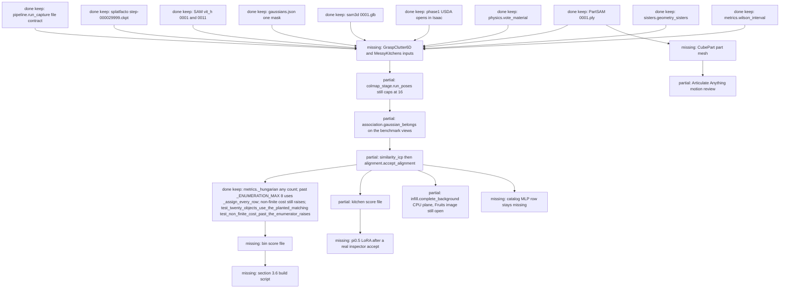

Build note. Inputs that stay: `examples/phase1_place_scene.json`, `docs/assets/example_videos/Fruits.mp4`, and the recorded host artifacts (`step-000029999.ckpt`, the two SAM masks, `gaussians.json`, `0001.glb`, `0001.ply`, the USDA opens). Output that unblocks a quoted number: two score files, one per protocol, written only after `Bench` exists. Extend `colmap_stage.run_poses`, `association.gaussian_belongs`, `similarity_icp.measure_residuals`, `alignment.accept_alignment`, and, for the bin file only, `metrics._hungarian`. The kitchen score file uses the seed-then-object average in section 10.8. A Fruits residual that fails `ours_iteration_1` stays a reject. Do not rebuild the keep nodes to manufacture that accept.

### 10.2 Association and alignment

Canvas rows: Gaussian association cuts are done for one Fruits mask. Trimmed similarity ICP and the alignment gate are partial. Multi-view grouping and the eleven reviewer images are still open.

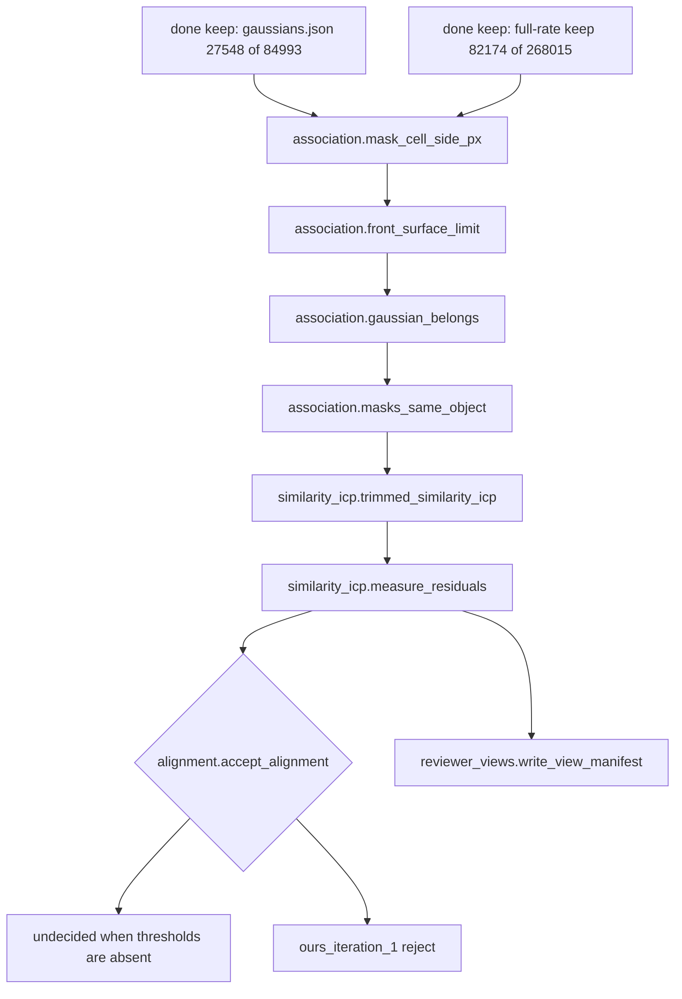

Build note. Inputs: splat centers from the kept full-rate checkpoint, SAM masks, and `0001.glb`. The stored SAM 3D rotation vector is absent, so `similarity_icp.rotation_seeds` searches quarter-turns. That search is not the paper's initial pose. Outputs: a residual JSON with `thresholds_published: false` and silhouette filled by the caller, plus the eleven view paths. `measure_residuals` leaves `silhouette` null. `accept_alignment` returns `undecided` with no threshold map. Passing `ours_iteration_1` rejects the recorded Fruits residuals on coverage and silhouette. Alignment constants stay `normalized_median` max 0.05, `p90` max 0.25, `coverage` min 0.5, `silhouette` min 0.5. `TRIM_KEEP` stays 0.7. Do not lower those cutoffs. Missing reviewer PNGs stay missing. Keep the grouping constants already in `association.py`: centroid distance within `min(0.10, 0.6 e)`, containment at least 0.18 or Jaccard at least 0.08. Kappa 1 keeps the union. A stricter consensus filter is a later caller, not a silent drop. Equation 1 stays one-sided, with `EPS_A` 0.08 and `EPS_R` 0.03 and cell side `min(16, round(short_side / 192))`, as section 6 records. The paper reports the kitchen at 0.90–0.93 m per reconstruction unit, so that absolute slack is about 7 cm on that capture, and it does not name how the scale was obtained. A VLM height guess does not become that scale.

### 10.3 Background planes and optional LaMa

Canvas row: LaMa background infill is partial. The CPU plane fit writes a rendered image. The Fruits image and LaMa are still open.

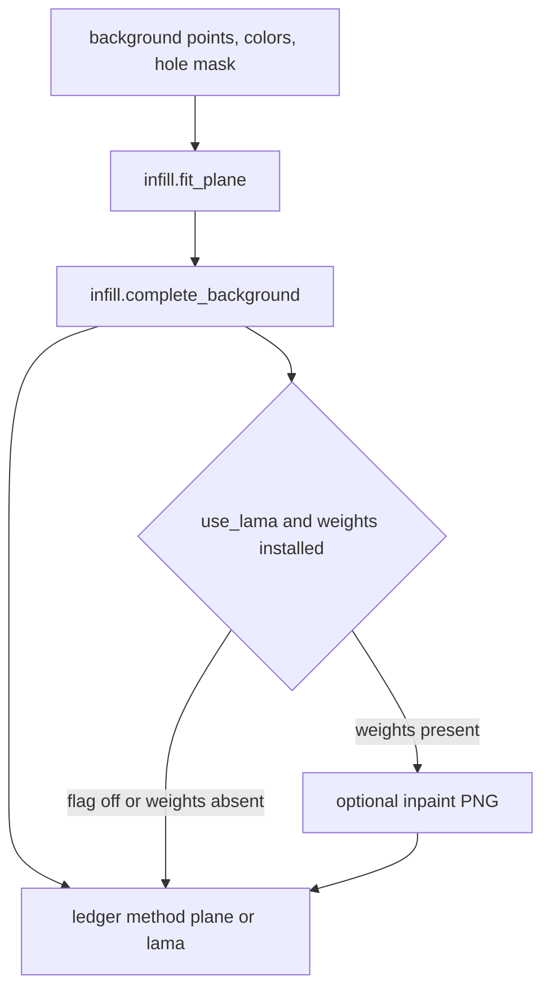

Build note. The CPU path is in `sceneagent.infill`. It does not read an ICP pose. Input: background points, one RGB color per point, and a 2D hole mask. Output that counts here: a plane-completion PNG whose hole pixels take the nearest plane-surface color, and a ledger entry with method, inputs, and outputs. `plane_infill` still writes nothing when the render is missing and no background points were passed, and it does not run LaMa just because a render exists. LaMa stays optional texture on that plane fill and is off by default. A forged PNG is a failed build. The remaining run is the Fruits background on Vast instance 58301075, through the existing GPU smoke, and it is not part of the CPU change.

### 10.4 Physics prior

Canvas row: the per-Gaussian MLP is missing. The trainer exists at `caf16b7`. The catalog row stays missing. A local npz is not Harvard's prior.

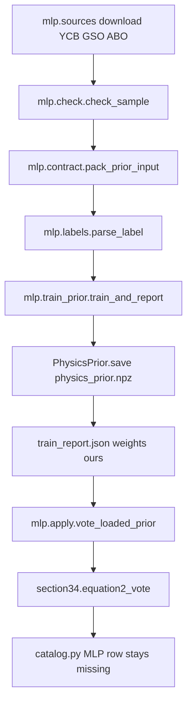

Build note. Inputs: `data/mlp/` label jsonl when present. That directory is gitignored. Outputs: `data/mlp/physics_prior.npz` and `train_report.json` with `weights: "ours"`, `section: "3.4"`, and `w_out_shape` `[32, 33]`. `train_and_report` stops before a gradient step when a source has fewer than 20 labels or the holdout split is too small. `vote_loaded_prior` averages in-mask 33-d outputs in chunks of 4096 and writes logs through `store_log_mass_density`. `equation2_vote` sets `claimed_mlp` false when the prior is absent. Slots 28–32 stay unnamed. Do not edit the catalog sentence to call this checkpoint the released Harvard weights. Do not fill Young's modulus, Poisson's ratio, or the rendering material.

### 10.5 Parts, completion, and joints

Canvas rows: PartSAM is done. CubePart is missing. Articulate Anything is partial. PartNet table 25959 was rejected for the fruit.

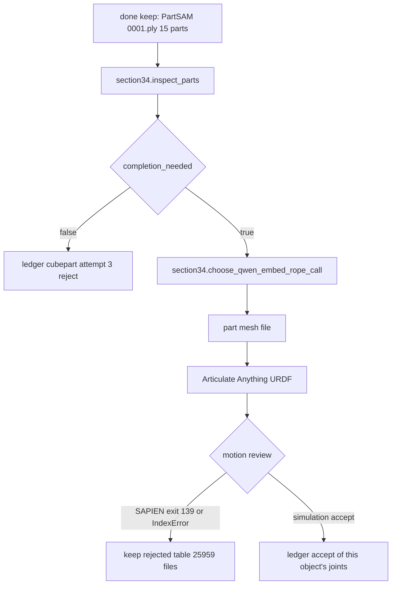

Build note. Input: `0001.glb` and the kept ply. The part VLM, `gemini-3.8-flash` after `gemini-2.5-flash` HTTP 404, set `completion_needed` false and described a table. Output that counts: a completion mesh only after a later reply says completion is needed, then a URDF whose links are those PartSAM parts, then a simulation review. Section 3.4 says agents review the articulation in simulation. Figure 7 names that review in Isaac. `fruits_agent.make_tools` does not launch PartSAM, CubePart, or Articulate Anything. Record a real run with `agent_loop.append_step`. Attempt 2 remains the diffusers 0.39 `QwenEmbedRope` TypeError. The two 13408-byte table URDFs, object 25959, five fixed joints, stay rejected. `sapien_simulate.py` exit 139 and `feedback_score` -1 stay a failed review. Pipeline A stage 9 is not this path.

### 10.6 Sisters

Canvas rows: model-free sisters are done. Meshy is missing. Scene and task sisters are partial.

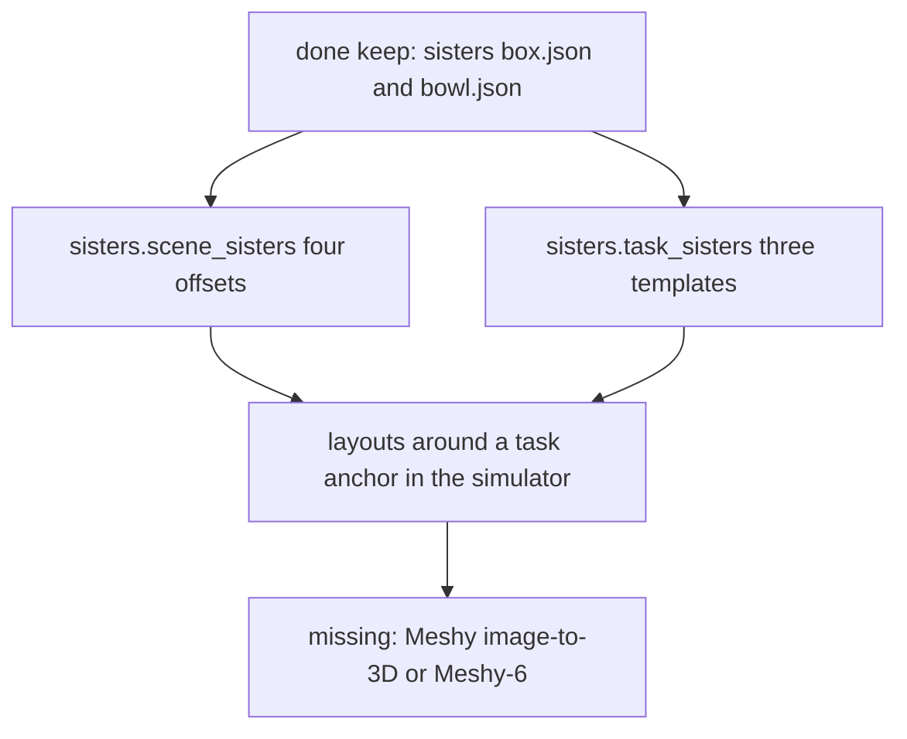

Build note. Inputs: the phase-1 box and bowl sizes. The length +5% sister does not fit the bowl. Grasp gates in the JSON have `published_in_paper: false`. The kept sister JSON already stores the paper's model-free texture: noise, hue rotation, mottling, and speckle, under `texture.noise`, `hue_degrees`, `mottle`, and `speckle`. Extending object sisters keeps those fields. Figure 15 shows seven variants of each of seven objects. Outputs that count as more than the templates: simulator layouts and a Meshy file whose route is Gemini 2.5 Flash, Gemini 3 Pro Image, and Meshy. Extend `sisters.scene_sisters` and `task_sisters` past the phase-1 templates. A CLIP similarity band is not a paper gate. Do not point pipeline B's Hunyuan cousins at the Meshy row. Do not rebake `box.json` onto `0001.glb` and call it the same done artifact.

### 10.7 Export and inspect

Canvas rows: the USD contract, the empty Isaac stage, the primitive inspector, the aligned-mesh USDA, and the MuJoCo load are done. The place is partial because `inside_bowl` is false. The inspector skill is `stage_opened`.

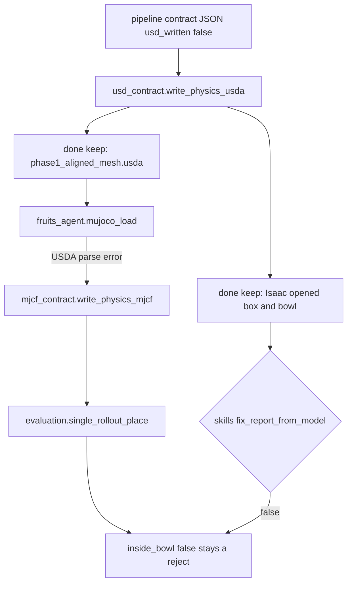

Build note. Inputs: `package/usd_physics_contract.json` and the kept USDA files. Null mass or density stays a comment in the USDA and uses loader density 1000 in the MJCF. Outputs already produced: `phase1_place.xml` (nbody 3, nq 7, 30 steps) and the hull file, 327 vertices and 650 faces. The full-rate drop ended at z 0.18175340000000004 m. Extend the place path only by a new rollout whose center is inside the target. `single_rollout_place` sets `not_a_learned_policy` and `rate_reported: false`. `SCENEAGENT-INSPECT-ISAAC` stays `stage_opened` until a coding model writes a fix report. Deformables, fracture, and fluids stay out of the USDA. The host glibc 2.31 still needs the jammy 2.35 loader. `python.sh` on host glibc segfaults. That is an environment fact, not a scene accept.

### 10.8 Scoring

Fruits is not an input to either flow. The paper's printed pairs stay the paper's comparison: bin 6.9% F1 and 4.29 cm Chamfer, kitchen 10.21% F1 and 11.67 cm Chamfer.

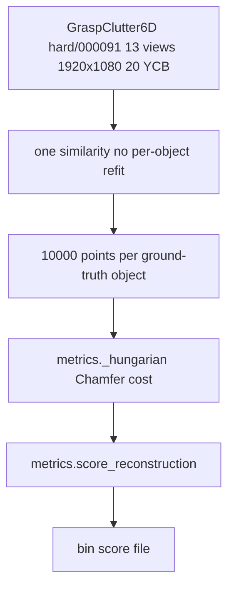

Build note for the bin. Input is the benchmark scene, not `0001.glb`. The views are 13 RGB frames at 1920×1080. Sampling is 10,000 surface points per ground-truth object. `metrics._hungarian` raises above 8 objects on a side, so the 20-object match is the function to extend. Keep `score_reconstruction`: the cost is `symmetric_chamfer`, which already applies the one-half factor in equation (4); F1 averages over all 20 reference objects with unmatched objects at 0; Chamfer averages over matched objects only. Output: one score file that names `hard/000091`, the point count, and the single similarity. 60.75% and 6.9% / 4.29 cm are not written into that file as this repo's result. F1 above 20% and Chamfer below 3 cm is not a printed pass line.

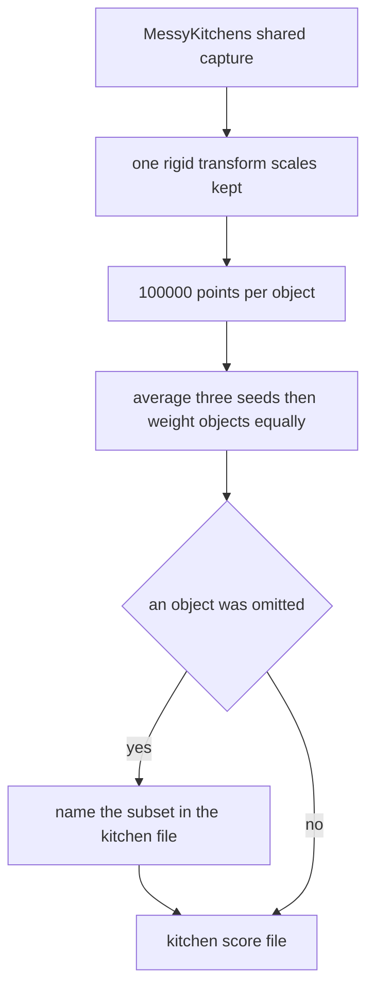

Build note for the kitchen. Ground-truth scans are used as the benchmark ships them. Sampling is 100,000 points per object. Each delivered mesh keeps its saved transform. One rigid transform aligns the run. Scales stay. No per-object refit. Both F1 and Chamfer average over the three sampling seeds and then over objects. That aggregator is not `score_reconstruction`. The bin function's unmatched-zero rule is the bin protocol. If a run omits an object the way the paper's Grok Build run omits the knife block, the file names the three-object subset. That subset is not the four-object kitchen score and not the bin score. Website bars rounded to one decimal, and website Chamfer pairs, stay off this file. `evaluation.sister_grid` is not either file.

### 10.9 4D and policy, after a real inspection accept

Both flows are not started. The static export's `fix_report_from_model: false` is the gate in front of them.

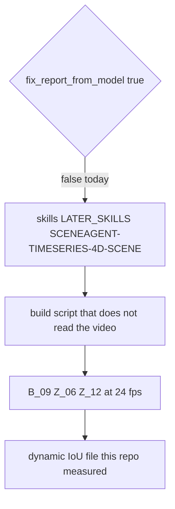

Build note. `SCENEAGENT-VIDEO-TO-4D` and `SCENEAGENT-TIMESERIES-4D-SCENE` are `not_implemented`. The artifact that counts as started is the build script plus a dynamic-IoU file this repo measured. The three cases are B_09, a liquid dam break around rigid cylindrical pillars, 130 frames at 1280×720; Z_06, a gel or liquid and a rigid sphere, 150 frames at 1280×720; and Z_12, a layered watermelon breaking on impact, 81 frames at 1600×900. All three are 24 fps. The script regenerates the camera, a triangle mesh of every rendered object at every frame, and persistent trajectories, at that frame count, resolution, and rate, without reading the video. Gels, elastoplastic solids, and liquids that interact with rigid bodies use the material point method. Incompressible liquids use FLIP. Brittle objects use fracture models. Particles are not deleted or reseeded. Equation (6) is the metric. The paper's 99.09% is Gemini 4 Argon's with-skills mean on these three cases, and it is not that file. Fracture stays a separate authored scene, outside the USD contract, and is not this script.

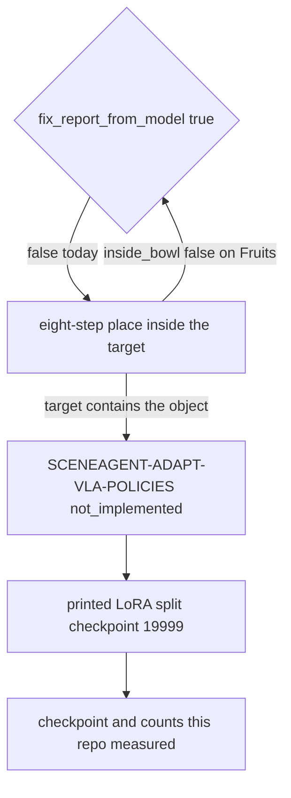

Build note. The Fruits hull miss is not an input. `sister_grid` sets `learned_policy_ran: false`. The scripted expert is approach, descend, grasp, lift, carry, lower, release, and retreat. An episode is kept when the object ends inside the target. On the eggplant task, success means the arm picks the toy up and drops it into the basket without dropping it. Observations are a depth composite of the mesh foreground, robot and objects included, over the splat. Objects settle under physics. While demonstrations are generated, object positions are drawn in a 42.9 by 9.8 cm box, yaw is drawn from `[0, 2π)`, target size scale is ±10%, the Franka base stays inside a 2 cm-radius disc, and exterior-camera pitch varies by ±2 degrees. Evaluation layouts randomize object position only. The finetune is pi0.5 DROID, simulation-only demonstrations. LoRA is rank 16 and alpha 16 on the Gemma-2B backbone, and rank 32 and alpha 32 on the 300M action expert. The base transformer stays frozen. The SigLIP vision encoder and the small action, state, and time heads train at full rank. Training is 20k steps, batch size 32, one H200, about 6.5 hours. Evaluation uses checkpoint 19999. The paper evaluates 200 simulation layouts and 50 real layouts. The artifact that counts as started is a checkpoint this repo wrote after episodes that end inside the target, with counts stored beside it. The printed eggplant table, including the 40-episode cell of 57/200 in simulation and 24/50 in the real world, stays the paper's. There is no LoRA trainer in `sceneagent` yet. The function to add sits behind the inspector gate. It does not call a figure-5 harness. `agent_loop.harness_status` stays `called: []` until one of those products is actually invoked.

### 10.10 Integration with pipelines A, B, and C

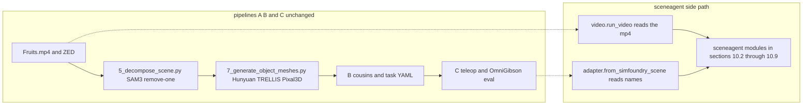

Build note. A build step may read `docs/assets/example_videos/Fruits.mp4` and a SimFoundry scene JSON. `from_simfoundry_scene` copies names out of `objects_info.init_info` and does not write the scene file back. Stage scripts under `scripts/pipeline/A_reconstruction`, `B_augmentation`, and `C_application` stay unmodified. A Hunyuan or TRELLIS mesh remains a pipeline A mesh. A pipeline B cousin remains a cousin. The side path's SAM 3D glb, Meshy file, and score files are new artifacts under the `sceneagent` run directory.

### 10.11 Paper constraints added from Dual Doc 2.0

Dual Doc 2.0 was checked against the Harvard PDF (arXiv:2610.34745v1). The sentences in this subsection are the protocol facts that sections 9 and 10 did not already give a builder. The build notes above are where each one changes a step. SceneagentX control code, host pins, and retired pass lines stay out of this plan.

- Association grouping stays `min(0.10, 0.6 e)`, containment at least 0.18 or Jaccard at least 0.08, with kappa 1 as the union. Equation 1 stays the one-sided test in section 6. The kitchen is reported at 0.90–0.93 m per reconstruction unit. The paper does not name the scale method.
- Plane completion colors new Gaussians from nearby plane surfaces. LaMa stays optional texture.
- Motion review follows section 3.4, which says simulation, and Figure 7, which names Isaac. The recorded SAPIEN exit stays a reject.
- Model-free sisters keep noise, hue rotation, mottling, and speckle. Figure 15 shows seven variants. A CLIP band is not a gate.
- Bin scoring extends `metrics._hungarian` and keeps `metrics.score_reconstruction`: Chamfer cost, equation (4), F1 over all 20 objects with unmatched at 0, Chamfer over matched objects only, 13 views at 1920×1080, one similarity, no per-object refit. Kitchen scoring averages both metrics over three seeds and then over objects, under one rigid transform. It does not call the bin aggregator. F1 above 20% and Chamfer below 3 cm is not a printed pass line. Website one-decimal bars stay off both files.
- The 4D script, once a real inspection accept exists, targets B_09, Z_06, and Z_12 at the frame counts, resolutions, and 24 fps in section 10.9, with MPM, FLIP, or fracture as that section states, and particles that are not deleted or reseeded. 99.09% is Gemini 4 Argon's with-skills mean.
- The policy function, behind the same inspection gate, uses the eight-step expert, the depth composite, the 42.9 by 9.8 cm demonstration box and the other printed randomizations, the split LoRA ranks, and checkpoint 19999. The episode table stays the paper's.

## 11. Match to the Harvard paper

This section checks every reproduction claim in section 9 and every build step in section 10 against Hollis, Fan, and Yang, arXiv:2610.34745v1, 26 October 2026. The text layer was readable on all 27 pages. Captions, equations (1) through (6), Figure 5's printed scores, and Tables 2 and 3 are in that text. Pages 10, 14, 15, and 22 are figure-heavy; their captions and labels were read from the text layer. No number below was taken from an unmarked chart pixel. Section 10.11 is unchanged. Code status is `sceneagent` at `caf16b7`.

### 11.1 Corrections

The sentences below stated a Harvard fact in a way the PDF does not support. Each one is now the paper's wording.

| Where | Paper | Old plan wording | Now |
|---|---|---|---|
| Section 9.1 bin row, section 10.8 bin diagram and note | Section 4.1: "We sample 10,000 surface points per ground-truth object" | "10,000 surface points" and `10000 surface points` | 10,000 surface points per ground-truth object |
| Section 9.1 kitchen row, section 10.8 kitchen diagram and note | Section 4.1: "We sample 100,000 points per object with three sampling seeds" | "100,000 points, three seeds" and `100000 points` | 100,000 points per object, then the three-seed average |
| Section 10.1 graph and build note | Section 4.1 names the Hungarian algorithm for GraspClutter6D. The kitchen paragraph uses one rigid transform and an equal weight per object | Edge `Match --> KitFile`, so the kitchen file waited on `metrics._hungarian` | The bin file is the Hungarian caller. The kitchen file leaves `Align` and uses the seed-then-object average |
| Section 9.4, 4D row | Figure 4 is the 4D token chart. Its S3 is "Physics simulation / continuum, MPM, fluid". Figure 6 is the bin chart | "Figure 6's S3 SplatGraph is also absent" inside the 4D row | The 4D row cites Figure 4 |
| Section 9.4, bin row | Figure 6 labels stage S3 "SplatGraph clustering". Section 3.3 publishes the centroid, containment, and Jaccard test | "S3 SplatGraph is not in the plan or the code" | The stage label is SplatGraph. The published test is `association.masks_same_object`, and it has not been run on the bin |
| Section 9.4, LaMa row | Section 3.3: "New Gaussians receive colors from nearby plane surfaces in the input images, with optional LaMa texture inpainting" | "A plane-completion render, then an optional inpaint file" | New background Gaussians on detected planes, colored from nearby plane surfaces, with optional LaMa |
| Section 9.4, experiment grid | Figure 14: each cell "reports place success over ten trials". Columns are lighting setups. The caption does not number those columns | "Ten trials by nine lights, with the interval on those counts" | Ten trials per cell, as Figure 14 prints. The nine names in `LIGHTING_SETUPS` stay this tree's website columns. A Wilson interval stays this tree's summary |

### 11.2 Claims that already match

**Object and capture.** Section 3.2 writes each Gaussian as center, covariance, opacity, and spherical-harmonic color, and each object as Gaussians, mesh, pose (rotation, translation, one uniform scale), physical properties, and joints. Sections 9 and 10 follow that object through association, SAM 3D, ICP, the physics vote, and joints.

**Section 3.3 association.** Equation (1) is one-sided: depth at or in front of the cell's front surface plus `max(0.08, 0.03 times that depth)`. The cell side is `round(shorter side / 192)` pixels and at most 16. `association.py` at `caf16b7` uses those constants. Multi-view grouping is centroid distance within `min(0.10, 0.6 e)`, and containment at least 0.18 or Jaccard at least 0.08. The paper's experiments use kappa 1, so the object keeps the union. Section 10.2 states those cuts and leaves `ours_iteration_1` where it is. In the kitchen the paper sets 0.90–0.93 m per reconstruction unit, about 7 cm for the absolute slack, and it names no scale procedure. Section 10.2 already says that.

**Features.** OpenCLIP ViT-B-16 is a 512-dimensional crop embedding. DINOv2 ViT-S/14 is the other visual feature. Section 3.3 says both feed the physics prior and neither decides membership. Equation (1) remains the membership test. The LangSplat citation is the feature-association approach, and the plan already refuses to treat a vendored LangSplat repo as that test.

**Mesh and gate.** SAM 3D generates the mesh. Trimmed similarity ICP uses one uniform scale and starts from the SAM 3D pose. Section 3.1 accepts a pose only when normalized median, 90th-percentile distance, coverage, and silhouette all pass fixed thresholds. The PDF prints no numeric cutoffs. Sections 9.3 and 10.2 keep `ours_iteration_1` and refuse to lower it so a Fruits residual passes.

**Background, parts, export.** Plane completion plus optional LaMa matches section 3.3, and section 10.3 already said the new Gaussians take color from nearby plane surfaces. PartSAM, then CubePart when a VLM asks for completion, then Articulate Anything, then a simulation review, matches section 3.4. Figure 7 names the articulation review in Isaac. The USD physics schema in section 3.7 covers rigid bodies, mass, collision, joints, friction, restitution, and density, and it does not carry deformable bodies, fracture, or fluids. `usd_contract.write_physics_usda` writes the rigid fields.

**Sisters.** Section 3.8 has two routes: bounded deformation of the object's own mesh plus a procedural texture of noise, hue rotation, mottling, and speckle, or Gemini 2.5 Flash, Gemini 3 Pro Image, and Meshy image-to-3D, with Meshy-6 for a retexture that keeps geometry and UVs. Figure 15's caption shows one converted object followed by seven generated variants, and the figure text names seven objects. Section 10.6 states that route. TRELLIS stays a pipeline A mesh. A CLIP similarity band is absent from the paper, and the plan already refuses it.

**Physics prior.** Section 3.4 specifies 10 material classes, 6 body types, 8 collision primitives, and nine numerical outputs, trained on GSO, YCB, and ABO with VLM labels rather than physical measurements. Mass and density are logarithms. An unknown vote is scaled by 0.4. An object becomes a soft body when deformability is at least 0.65. Young's modulus, Poisson's ratio, and the rendering material are a class lookup. The ten, six, and eight names in `taxonomy.py` match the printed lists. Equation (2) is the weighted class vote. Per-Gaussian outputs are averaged over the object's Gaussians, which is what `vote_loaded_prior` does.

**Section 4 reconstruction, kept separate.** GraspClutter6D `hard/000091` is 20 YCB objects and 13 RGB views at 1920×1080, one similarity for the run, no per-object refit. Hungarian matching uses Chamfer distance as the cost. Equation (4) is the symmetric mean nearest-point distance, and `symmetric_chamfer` applies the one-half factor. Equation (5) is F1 at 1 cm, with F1 equal to 0 when precision plus recall is 0. F1 averages over all 20 ground-truth objects and an unmatched object scores 0. Chamfer averages over matched objects only. The kitchen uses the benchmark meshes as shipped, one rigid transform, scales kept, 100,000 points per object, three seeds, and an equal weight per object. SimFoundry on the bin, Figure 5 and section 4.1, is 6.9% F1 and 4.29 cm Chamfer, labeled "NVlabs, stage 10, native scale" in the figure. SimFoundry on the kitchen, in the incomplete-runs paragraph, is 10.21% F1 and 11.67 cm Chamfer. Grok Build omits the knife block; on the matched three-object subset F1 goes from 5.67% to 17.68% and Chamfer from 5.25 cm to 2.81 cm. The phrase "F1 above 20% and Chamfer below 3 cm" is absent from the PDF, and sections 10.8 and 10.11 already say it is not a pass line. Fruits and the master-chef can are absent from these table rows.

**60.75% and 99.09% are printed in this PDF.** The abstract, Figure 5 (Codex, with SceneAgent), section 4.1 ("from 9.51% to 60.75% for Codex"), and the conclusion print 60.75% as the bin's best F1, beside SimFoundry's 6.9%. That number is a Harvard result. It is not a score this tree has written. Equation (6) is dynamic IoU on B_09, Z_06, and Z_12, excluding a thin boundary band. The abstract, section 4.2, and the conclusion print Gemini 4 Argon's with-skills mean as 99.09%, up from 0.86%. Section 10.9's frame counts, resolutions, 24 fps, MPM, FLIP, fracture, and the build script that does not read the video match sections 3.6 and 4.2.

**Policy.** Section 4.4 fine-tunes π0.5 (DROID) only: LoRA rank 16 and alpha 16 on the Gemma-2B backbone, rank 32 and alpha 32 on the 300M action expert, base transformer frozen, SigLIP and the small action, state, and time heads at full rank, 20,000 steps, batch 32, one H200, about 6.5 hours, checkpoint 19999. Demonstrations are simulation-only. Evaluation uses 200 simulation layouts and 50 real layouts. The scripted expert is approach, descend, grasp, lift, carry, lower, release, and retreat. A kept episode ends with the object inside the target. On the eggplant task, success means the arm picks the toy up and drops it into the basket without dropping it on the way. The printed randomizations match section 10.9: a 42.9 by 9.8 cm box, yaw over a full turn, target scale ±10%, a 2 cm base disc, and exterior pitch ±2 degrees, with evaluation randomizing object position only. Table 2's 40-episode cell is 57/200 in simulation and 24/50 in the real world. That real count is the peak of the cells that print a real count. Later printed real counts are 20/50, 10/50, 12/50, 11/50, and 6/50. The 10k row prints 102/200 in simulation and leaves the real cell blank. The 10, 1k, and 20k rows also leave the real cell blank. Table 3 policy 3 is 170/200 in simulation and 44/50 in the real world. The plan's 40-episode example already matches Table 2, and it already leaves the whole table as the paper's.

**Baseline.** The SimFoundry abstract (arXiv:2606.28276) evaluates Pearson correlation between simulation and real performance, and training gains from object, scene, and task cousins. Section 9.1 keeps that protocol separate from SceneAgent section 4.1.

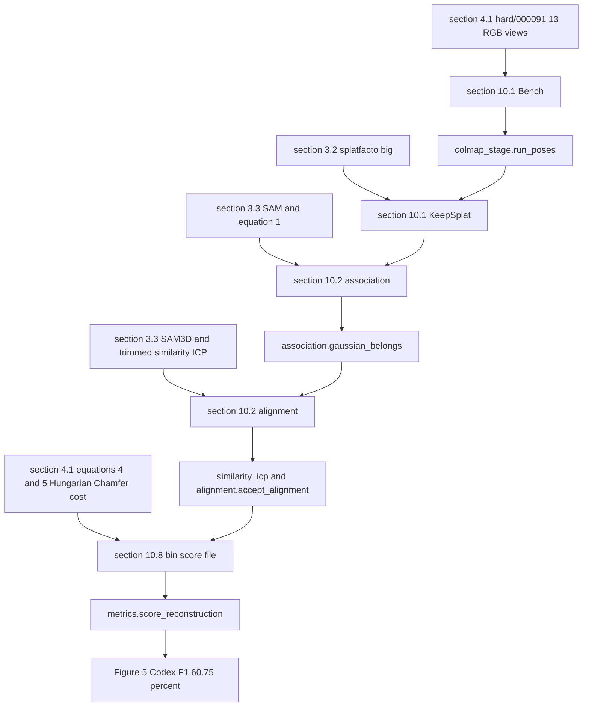

The last node is the number printed in the Harvard PDF. `metrics.score_reconstruction` is the module a future bin file would call. That file, once written, carries the count this tree measured. The kitchen pair, 10.21% F1 and 11.67 cm Chamfer, stays on the section 10.8 kitchen path.

### 11.3 The paper is silent, so these stay ours

- SAM in the PDF is Kirillov et al. 2023, every tenth view by default, with the stride ranging from 1 to 10 across scenes. `vit_h` is the host checkpoint named in section 9.4.
- The OpenCLIP string `openai`, the stored DINOv2 width 384, the 1 fps and 16-frame cap, the 452-frame host model, and the 30,000-iteration splatfacto settings are this tree's or the host's. The paper names COLMAP and splatfacto big and does not print those run settings.
- `ours_iteration_1` cutoffs, `TRIM_KEEP` 0.7, and the quarter-turn rotation seeds are this tree's. The paper's four thresholds and its trim ratio are unpublished, and the initial pose is the stored SAM 3D pose.
- Keyword phrases, keyword weight 1.0, and a VLM weight of 1.0 when confidence is missing are this tree's. The paper says keyword priors use a fixed weight and other sources use confidence.
- MLP width 32, tanh layers, the 4,096-row chunk, the holdout list that includes `002_master_chef_can`, and the early-stop counts are this tree's. Slots 28–32 are this tree's index for the five numerical heads the paper leaves unnamed, after log mass, log density, rigidity, and deformability. The local npz stamped `weights: "ours"` and the catalog row that stays `missing` are this tree's status. The PDF contains no checkpoint.
- The class lookup for Young's modulus and Poisson's ratio is unpublished. The vote leaves those fields unresolved. The ceramic 6 GPa figure in section 3.5 is an engineering estimate for the authored fracture scenes, and section 9.4 already keeps those numbers out of a copied log.
- Grasp extent 0.005 m, volume-ratio band 0.5 to 1.5, and length scales 0.95 and 1.05 are this tree's. The paper checks extent, volume, and graspability and prints no bounds.
- The nine lighting names and the Wilson interval are this tree's. Figure 14 prints ten trials per cell.
- Fruits paths, residual coverages, the missed bowl drop, Gemini fallback ids, PartNet 25959, and the SAPIEN exit are host records. They are not rows in section 4.
- A CLIP band of 0.80 to 0.95 is absent from the PDF. TRELLIS is the SimFoundry mesh stage, not a Harvard sister generator.
- The code has no kappa argument. Keeping every associated Gaussian matches the paper's kappa-1 experiments. A stricter camera-consensus filter remains a later caller.
